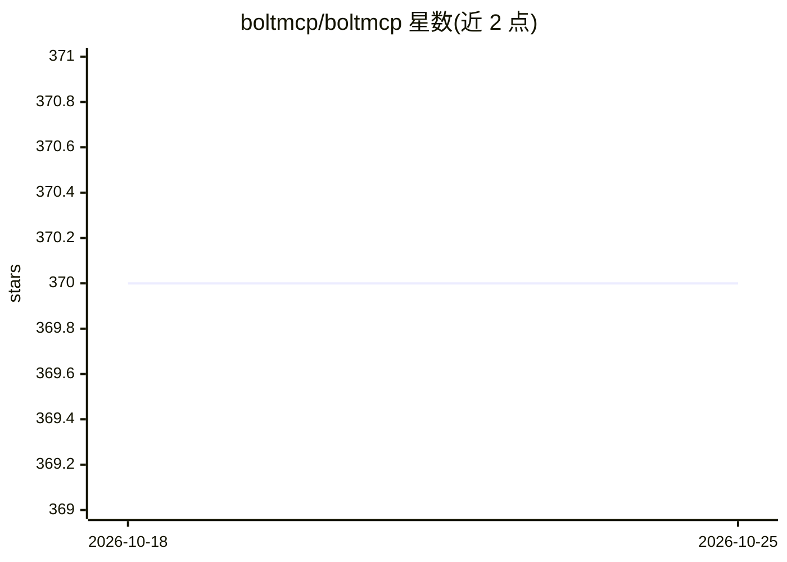

# boltmcp/boltmcp

⭐ 370 · HCL · 推送 2026-10-22 · [GitHub](https://github.com/boltmcp/boltmcp) · [官网](https://install.boltmcp.io) · 组织维护

**在 Kubernetes 上部署 BoltMCP 的安装工具，支持 Claude 引导安装**

面向使用 Claude Code 的开发者，提供在任意 Kubernetes 集群上安装 BoltMCP 的途径：官方路径为单个 Helm chart 部署，可通过 Claude Code 内的 /install-boltmcp 技能以自然语言指令完成安装、更新与卸载；前置步骤包括克隆仓库、放置访问密钥文件到 keys 目录并登录 Claude。也提供手动安装入口（install.boltmcp.io）。README 仅覆盖安装流程，未展示 BoltMCP 本身的运行功能细节。

## 筛选速览

| 维度 | 判定 | 备注 |
|---|---|---|
| AI 角色 | `ai-ecosystem` | LLM/agent 周边工具 |
| 许可风险 | `none` | — |
| 部署形态 | `library` | 以包/库形式分发 |
| 模型依赖 | locked-api |  |
| 硬件要求 | — | 无带数字的原话,不猜 |
| 安装摩擦 | `low` | 无编译、无系统依赖或容器化 |
| 成熟度 | — | 结构信号不足 |

## 能力要点

- 单个 Helm chart 部署到任意 Kubernetes 集群
- Claude Code 技能 /install-boltmcp 引导安装/更新/卸载
- 提供手动安装的替代入口

## 适用场景

- 我需要在 Kubernetes 集群上部署 BoltMCP
- 我想通过 Claude 对话完成安装与更新操作

## 场景标签

 · 领域:LLM 基础设施/MCP 部署

## 证据(README 行号)

> L3: BoltMCP installs on any Kubernetes cluster with a single Helm chart.
> L35: /install-boltmcp Install BoltMCP on a new cluster

## 星数曲线

2026-10-18 370 → 2026-10-25 370（+0）

---
*卡片 v1 · prompt 1.4 · 生成 2026-10-22 · 置信度 mid · 依据 README sha `a83c7c4e59e3` · [字段定义](../../DATASET.md)*
