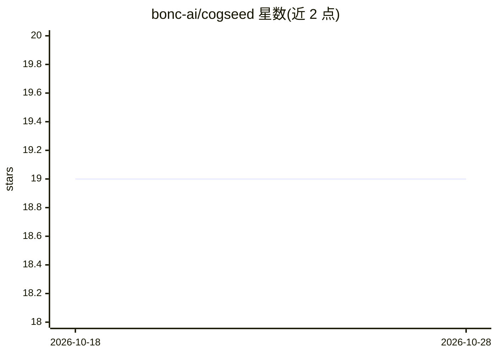

# bonc-ai/cogseed

⭐ 19 · TypeScript · MIT · 推送 2026-10-28 · [GitHub](https://github.com/bonc-ai/cogseed) · [官网](https://cogseed.ai) · 组织维护 · 中文 README

**把已确认经验转为可复用认知资产的个人伴侣 Agent 桌面应用**

面向个人开发者的桌面 Agent 工作区（macOS/Windows，Electron）。任务结束后从工作过程提取候选经验（偏好、约束、有效做法），经用户确认成为带来源、版本与作用域的“认知资产”，在后续相关任务或切换其他 Agent（Claude Code、Codex、OpenCode、WorkBuddy）时复用；支持导入历史会话并接力执行、Commander 多 Agent 协作、Skills/MCP 连接器扩展，兼容 IEEE P3394。开源构建可免登录本地使用，提取候选经验需配置模型或可用本地 CLI；资产确认需人工审核，不会静默写入长期记忆。

## 筛选速览

| 维度 | 判定 | 备注 |
|---|---|---|
| AI 角色 | `ai-ecosystem` | LLM/agent 周边工具 |
| 许可风险 | `permissive` | MIT |
| 部署形态 | `desktop` | 安装包/桌面程序 |
| 模型依赖 | — | README 未给出锁定关系 |
| 硬件要求 | — | 无带数字的原话,不猜 |
| 安装摩擦 | `low` | 无编译、无系统依赖或容器化 |
| 成熟度 | `idea` | |

## 能力要点

- 任务后提取候选经验，用户确认后成为带来源/版本/作用域的认知资产
- 在 Claude Code、Codex、OpenCode、WorkBuddy 间导入会话并接力执行任务
- Commander 多 Agent 协作，单界面查看计划、进度与交付物
- 支持 Skills、MCP 连接器与知识库，无需改源码

## 适用场景

- 不想每次都向 AI 重复解释项目规则与个人偏好
- 从 Codex 切换到 Claude Code 等其他 Agent 时延续任务进度
- 跨任务沉淀并受控地复用已验证的工作经验

## 场景标签

`Agent 记忆` `多智能体` `AI 助手` · 领域:Agent 开发

## 证据(README 行号)

> L17: **CogSeed is your personal companion agent.**
> L101: |Agent|CogSeed version|Import past sessions|Continue execution|
> L117: |Built-in model execution for the Commander and Task Agent|Configure an available model in **Models & Quota**; you

## 星数曲线

2026-10-18 19 → 2026-10-28 19（+0）

---
*卡片 v1 · prompt 1.4 · 生成 2026-10-28 · 置信度 mid · 依据 README sha `2441190121ff` · [字段定义](../../DATASET.md)*
