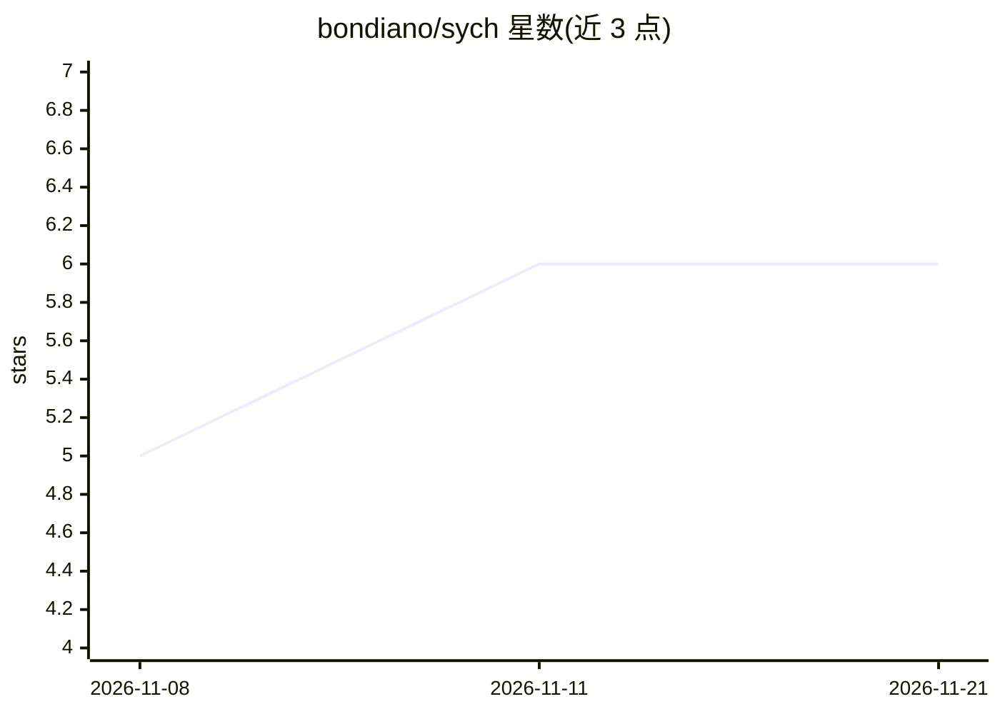

# bondiano/sych

⭐ 6 · Rust · Apache-2.0 · 推送 2026-11-18 · [GitHub](https://github.com/bondiano/sych) · 个人维护

**确定性核心的代码审查 CLI/GitHub App：模型调用受限、发现带出处**

以 Rust 编写的代码审查工具：确定性引擎规划检查项、收集证据并计算结论，模型仅在固定预算内提出假设与评估；每条发现引用确切代码，缺口以 UNKNOWN 报告而非沉默。事实来源包括固定版本的语言服务器（rust-analyzer、TypeScript、Go、Python）、语法解析器、linters 与 CI 报告。提供本地 CLI（review/show/explain 等）、自托管 GitHub App 服务器与 /v1 HTTP API，模型经 OpenRouter 及订阅渠道调用，每次调用有金额上限与账本记录。

## 筛选速览

| 维度 | 判定 | 备注 |
|---|---|---|
| AI 角色 | `ai-native` | 本体是模型或模型工具 |
| 许可风险 | `permissive` | Apache-2.0 |
| 部署形态 | `library` | 以包/库形式分发 |
| 模型依赖 | locked-api |  |
| 硬件要求 | — | 无带数字的原话,不猜 |
| 安装摩擦 | `low` | 无编译、无系统依赖或容器化 |
| 成熟度 | — | 结构信号不足 |

## 能力要点

- 确定性 planner/reducer 架构，模型仅在有界预算内参与
- 每条发现引用确切代码，信息缺口输出 UNKNOWN
- 语义事实来自固定版本语言服务器与 linters/CI 报告（cargo/clippy、JUnit、SARIF、LCOV 等）
- 提供本地 CLI、自托管 GitHub App 服务器与 /v1 HTTP API

## 适用场景

- 在 pull request 上自动生成带代码出处与覆盖报告的审查意见
- 本地对仓库运行不调用模型的免费试审
- 以迁移/Terraform/Kubernetes 部署模型约束部署相关规则检查

## 场景标签

`代码审查` · 领域:编码与开发

## 证据(README 行号)

> L8: **Sych** (Russian *сыч*, the little owl) is a code reviewer with a deterministic Rust core and bounded model calls.
> L9: The engine decides what must be checked, collects evidence and computes the verdict; models only propose
> L68: - **Bounded models.** OpenRouter with pinned upstreams and ChatGPT, GLM Coding Plan and OpenCode Go subscriptions.

## 星数曲线

2026-11-08 5 → 2026-11-21 6（+1）

---
*卡片 v1 · prompt 1.4 · 生成 2026-11-20 · 置信度 mid · 依据 README sha `5c5d9aa25ba6` · [字段定义](../../DATASET.md)*
