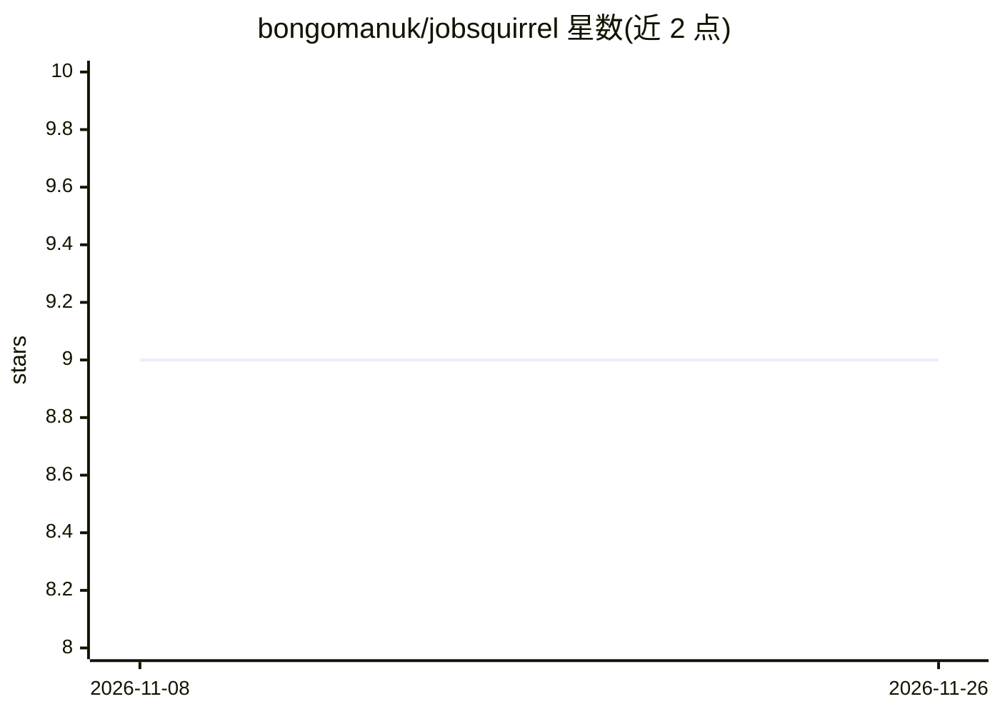

# bongomanuk/jobsquirrel

⭐ 9 · Python · Apache-2.0 · 推送 2026-11-23 · [GitHub](https://github.com/bongomanuk/jobsquirrel) · [官网](https://bongomanuk.github.io/jobsquirrel/) · 个人维护

**自托管求职申请流水线：代找职位、定制 CV、代投并跟踪回复**

本地运行的求职申请流水线：从职位提醒、招聘邮件和公开网络发现岗位，基于用户提供的证据为每个岗位生成真实的定制 CV（仅在广告要求时附求职信），发送前经准确性、ATS 适配与 AI 文风检查门禁，通过真实浏览器在雇主 ATS 页面完成投递，并在统一登记表中跟踪申请与回复。需借助 opencode、Claude Code 等文件与 shell agent 完成安装引导和运行，模型可用托管或本地；邮件与日历写入需用户显式批准。

## 筛选速览

| 维度 | 判定 | 备注 |
|---|---|---|
| AI 角色 | `ai-native` | 本体是模型或模型工具 |
| 许可风险 | `permissive` | Apache-2.0 |
| 部署形态 | `None` |  |
| 模型依赖 | — | README 未给出锁定关系 |
| 硬件要求 | — | 无带数字的原话,不猜 |
| 安装摩擦 | `low` | 无编译、无系统依赖或容器化 |
| 成熟度 | — | 结构信号不足 |

## 能力要点

- 按岗位定制 CV 与求职信，每条生成内容须有 CV、档案或知识图谱依据
- 发送前的硬门禁：对齐、证据、ATS 覆盖、身份与 AI 文风检查
- 以真实 Camoufox 浏览器通过雇主自有 ATS 投递，并自适应陌生表单
- 统一登记表跟踪角色、申请、回复，重复投递与雇主投递上限自动跳过

## 适用场景

- 批量管理多岗位申请并记录每份发出的材料版本
- 让 agent 依据我的证据定制每份 CV 并过检查门禁
- 在统一面板里跟踪各岗位的回复、面试与结果
- 在接触前识别招聘骗局（远程操控面试、收费上岗等）

## 场景标签

`工作流自动化` `浏览器自动化` `AI 写作` · 领域:效率与自动化

## 证据(README 行号)

> L12: Give it your CV and your rules. It finds roles, writes a truthful CV for each one
> L34: - **Apply** through the employer's own ATS with a real browser, not a form-spam script.
> L76: Works with opencode, Claude Code, Cursor or any file-and-shell agent. Use a

## 星数曲线

2026-11-08 9 → 2026-11-26 9（+0）

---
*卡片 v1 · prompt 1.4 · 生成 2026-11-20 · 置信度 high · 依据 README sha `78e10ec572f1` · [字段定义](../../DATASET.md)*
