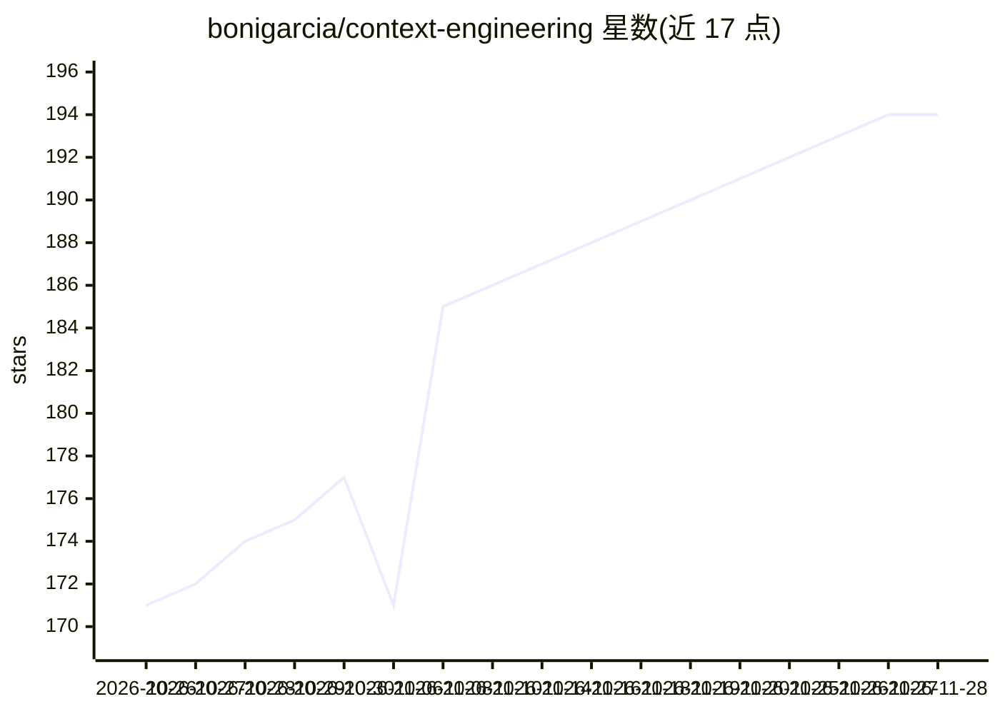

# bonigarcia/context-engineering

⭐ 194 · Python · Apache-2.0 · 推送 2026-11-27 · [GitHub](https://github.com/bonigarcia/context-engineering) · [官网](https://hubs.la/Q04ksQ8J0) · 个人维护

**面向从业者的上下文工程书籍配套资源与示例集**

Manning 出版的《Context Engineering》一书的配套仓库，按 12 章组织示例代码，覆盖模型交互、指令设计、RAG、工具调用、记忆与状态、提示技术、多智能体编排、评测可观测性、治理运维与 AI 框架选型，示例以 Python/Jupyter/JavaScript/Java 多语言提供。仓库含 9 个开放 Agent Skills 格式的技能（可审计 AGENTS.md、工具定义、RAG 管线等工件并输出报告），可作为 Claude Code 或 Codex 插件安装，另附提示构建器、SDLC 提示库、生态索引等 6 个在线页面。

## 筛选速览

| 维度 | 判定 | 备注 |
|---|---|---|
| AI 角色 | `ai-knowledge` | 知识聚合/清单类 |
| 许可风险 | `permissive` | Apache-2.0 |
| 部署形态 | `None` |  |
| 模型依赖 | local-ok | 支持本地模型 |
| 硬件要求 | — | 无带数字的原话,不猜 |
| 安装摩擦 | `low` | 无编译、无系统依赖或容器化 |
| 成熟度 | — | 结构信号不足 |

## 动量与使用信号

- 安装:github 包 `release-assets` 月下载无数据

## 能力要点

- 按 12 章组织的多语言示例（Python/Jupyter/JavaScript/Java）
- 9 个开放 Agent Skills 格式技能，输出带章节引用的审计报告
- 可安装为 Claude Code 或 Codex 插件
- 附 AI 生态索引、提示构建器、技术雷达等在线页面

## 适用场景

- 学习并实践上下文工程各环节的设计方法
- 为自己的 agent 管线/工件获取技能化审计报告
- 查找与对比提示工程、RAG、多智能体相关框架与资料

## 场景标签

`教程课程` `提示工程` · 领域:Agent 开发

## 证据(README 行号)

> L11: This GitHub repository is intended to be a companion resource for this book and a reference for practitioners looki
> L17: This repository organizes examples by chapter to help you explore context engineering concepts in practice.
> L122: The skills folder contains a collection of agent skills that apply the methods of each chapter (from Chapter 2 to 

## 星数曲线

2026-10-26 171 → 2026-11-28 194（+23）

---
*卡片 v1 · prompt 1.4 · 生成 2026-11-25 · 置信度 high · 依据 README sha `04dcfc953ec3` · [字段定义](../../DATASET.md)*
