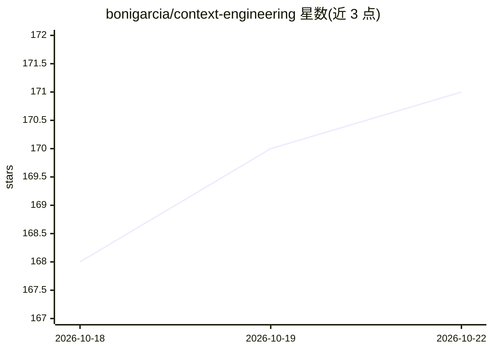

# bonigarcia/context-engineering

⭐ 171 · Python · Apache-2.0 · 推送 2026-10-22 · [GitHub](https://github.com/bonigarcia/context-engineering) · [官网](https://hubs.la/Q04ksQ8J0) · 个人维护

**上下文工程书籍的配套代码示例与在线资源库**

Boni Garcia 所著《Context Engineering》一书的配套仓库：按 12 章组织示例代码，覆盖模型提供方交互、指令、RAG、工具（MCP）、记忆与状态、提示技术、上下文编排、评测观测、治理、AI 框架、面向软件开发的应用及前沿综述，示例提供 Python/Jupyter/JavaScript/Java 多语言版本。另含 5 个在线资源：AI 生态索引、上下文感知提示构建器、SDLC 提示库、上下文工程雷达与参考文献目录。面向采用上下文工程实践的开发者。

## 筛选速览

| 维度 | 判定 | 备注 |
|---|---|---|
| AI 角色 | `ai-knowledge` | 知识聚合/清单类 |
| 许可风险 | `permissive` | Apache-2.0 |
| 部署形态 | `None` |  |
| 模型依赖 | — | README 未给出锁定关系 |
| 硬件要求 | — | 无带数字的原话,不猜 |
| 安装摩擦 | `low` | 无编译、无系统依赖或容器化 |
| 成熟度 | — | 结构信号不足 |

## 动量与使用信号

- 安装:github 包 `release-assets` 月下载无数据

## 能力要点

- 12 章示例代码，含 Python/Jupyter/JavaScript/Java 多语言实现
- 覆盖 OpenAI/Anthropic/Google/Ollama 等模型提供方的基础与流式交互
- 5 个配套在线工具：生态索引、提示构建器、SDLC 提示库、雷达与参考目录

## 适用场景

- 跟书学习上下文工程各主题的可运行示例
- 查找不同框架与工具在上下文工程中的用法
- 复用结构化提示模板与 SDLC 角色提示库

## 场景标签

`教程课程` · 领域:学习与行业

## 证据(README 行号)

> L5: Tobi Lütke, the CEO of Shopify, coined the term _context engineering_ in a tweet on June 19, 2025. He defined contex
> L9: This GitHub repository is intended to be a companion resource for this book and a reference for practitioners lookin

## 星数曲线

2026-10-18 168 → 2026-10-22 171（+3）

---
*卡片 v1 · prompt 1.4 · 生成 2026-10-18 · 置信度 high · 依据 README sha `36f3a182ccb0` · [字段定义](../../DATASET.md)*
