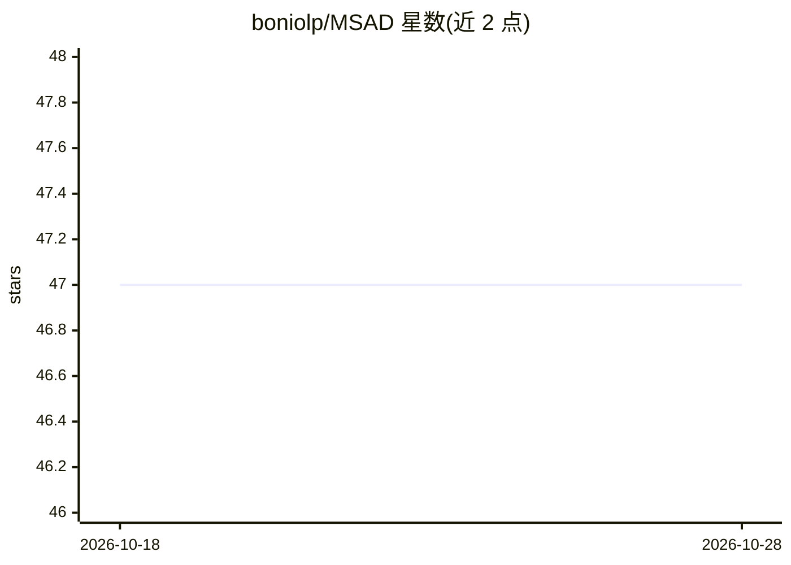

# boniolp/MSAD

⭐ 47 · Jupyter Notebook · MIT · 推送 2025-12-02 · [GitHub](https://github.com/boniolp/MSAD) · [官网](https://adecimots.streamlit.app/) · 组织维护

**时间序列异常检测的模型选择流水线与实验评估（VLDB 2023）**

面向时序异常检测研究者的模型选择框架：将模型选择建模为时间序列分类问题，对已有分类算法（深度架构 resnet/convnet、Rocket、TSFresh 特征+多种分类器）做大量实验评估，并引入模拟精度的 Oracle 与平均集成作为对照基线。以 Python 源码仓库提供，需 git clone、conda 环境安装，从 Google Drive 下载 TSB 数据集与预训练权重后运行脚本复现结果。特征计算阶段内存要求高（作者标注需 512GB RAM）。另有 VLDB Journal 2025 扩展版 MSADv2 仓库。

## 筛选速览

| 维度 | 判定 | 备注 |
|---|---|---|
| AI 角色 | `ai-native` | 本体是模型或模型工具 |
| 许可风险 | `permissive` | MIT |
| 部署形态 | `desktop` | 安装包/桌面程序 |
| 模型依赖 | — | README 未给出锁定关系 |
| 硬件要求 | — | 无带数字的原话,不猜 |
| 安装摩擦 | `medium` | 含编译或系统依赖之一 |
| 成熟度 | — | 结构信号不足 |

## 能力要点

- 将模型选择建模为时序分类问题并做系统性评估
- 覆盖深度架构（resnet/convnet）、Rocket 与 TSFresh 特征分类器
- Oracle 模拟（可调精度与随机模式）与 Averaging Ensemble 基线
- 提供预训练权重与数据集下载以复现论文结果

## 适用场景

- 为我的时序数据选择合适的异常检测模型
- 复现 VLDB 2023 论文的实验评估结果
- 对比模型选择方法与单个异常检测器的表现

## 场景标签

`模型评测` · 领域:评测与运维

## 证据(README 行号)

> L9: MSAD proposes a pipeline for model selection based on time series classification and an extensive experimental evalu
> L170: python3 train_deep_model.py --path=data/TSB_512/ --split=0.7 --file=experiments/supervised_splits/split_TSB_512.cs
> L255: python3 train_feature_based.py --path=data/TSB_512/TSFRESH_TSB_512.csv --classifier=knn --split_per=0.7 --file=exp

## 星数曲线

2026-10-18 47 → 2026-10-28 47（+0）

---
*卡片 v1 · prompt 1.4 · 生成 2026-10-25 · 置信度 mid · 依据 README sha `132a0eb95ef1` · [字段定义](../../DATASET.md)*
