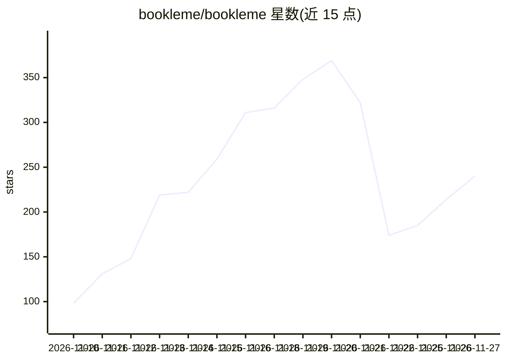

# bookleme/bookleme

⭐ 240 · Python · MIT · 推送 2026-11-25 · [GitHub](https://github.com/bookleme/bookleme) · 个人维护 · 中文 README

**把书籍编译成可安装 Agent Skill 的 Python 编译工具链**

BookLeme 提供从书籍/论文/网页到 Agent Skill 的编译流水线（S0–S9），生成知识包与行为 Skill 两类产物。采用编译期/运行期分离、共享中间表示、可插拔体裁插件与逐字引文忠实度回验（7 项指标），并设 6 条版权硬门与默认私有的分发策略。本体不自带大模型：确定性步骤留在 Python，主观判断由宿主 Agent 承接或可选配置外部模型 API。核心零第三方依赖，仅用 Python 标准库。

## 筛选速览

| 维度 | 判定 | 备注 |
|---|---|---|
| AI 角色 | `ai-ecosystem` | LLM/agent 周边工具 |
| 许可风险 | `permissive` | MIT |
| 部署形态 | `None` |  |
| 模型依赖 | — | README 未给出锁定关系 |
| 硬件要求 | — | 无带数字的原话,不猜 |
| 安装摩擦 | `medium` | 含编译或系统依赖之一 |
| 成熟度 | — | 结构信号不足 |

## 能力要点

- 双引擎产物：knowledge_pack 知识包与 behavior_skill 行为 Skill，共享中间表示
- 逐字忠实度回验：每条引文须为原文精确子串，7 项指标区分 measured/heuristic
- 可插拔体裁插件，新增体裁只需写一个文件，内置 4 种
- 6 条版权硬门（引文长度/占比/shingle 重叠等）+ provenance manifest，默认私有

## 适用场景

- 把一本专业书编译成可查阅的知识包给 Agent 检索调用
- 把方法论类书籍编译成可运行的教练对话 Skill
- 编译论文/网页资料并保留图示锚定与出处复核信息

## 场景标签

`知识库管理` · 领域:知识与检索

## 证据(README 行号)

> L60:  01 · 编译期 / 运行期分离 书只在编译时读一遍，运行时按需加载知识分片。
> L177: BookLeme 是个 **harness**：它编排流程，但不自带大模型。真正做判断的智能体就在现场——
> L178: 调用 `bookleme run` 的那个 Agent（WorkBuddy / Claude Code / Codex…）本身就是大模型。

## 星数曲线

2026-11-10 98 → 2026-11-27 240（+142）

---
*卡片 v1 · prompt 1.4 · 生成 2026-11-27 · 置信度 high · 依据 README sha `80ebd8f41922` · [字段定义](../../DATASET.md)*
