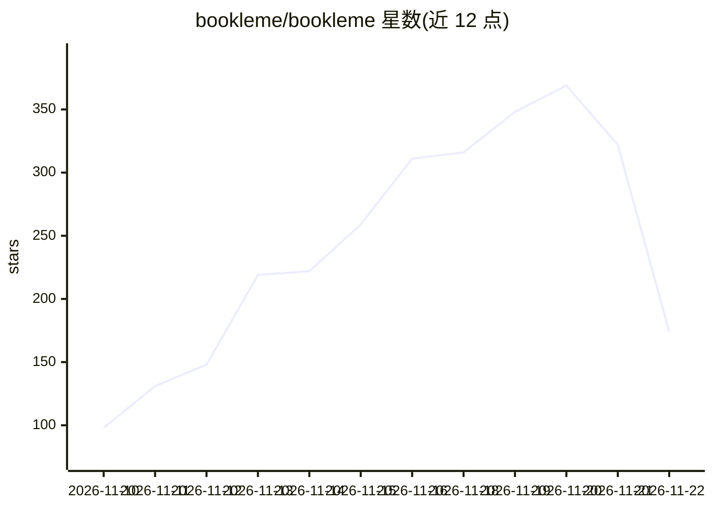

# bookleme/bookleme

⭐ 174 · Python · MIT · 推送 2026-11-13 · [GitHub](https://github.com/bookleme/bookleme) · 组织维护 · 中文 README

**把整本书编译成可安装 Agent Skill 的工具链**

面向开发者的书→Skill 编译器：以 S0–S9 流水线处理书籍文本，双引擎（knowledge_pack 知识包 / behavior_skill 行为 Skill）按 12 个确定性体裁特征自动路由，两引擎共享中间表示。支持可插拔体裁插件（内置 4 种，新增体裁写一个文件）。忠实度方面设 7 个指标，逐字引文必须是原文精确子串；版权方面 6 条确定性硬门、产物默认私有。核心零第三方依赖（仅 Python 标准库），LLM 抽取器为 OpenAI 兼容可选组件，缺配置自动回退。

## 筛选速览

| 维度 | 判定 | 备注 |
|---|---|---|
| AI 角色 | `ai-ecosystem` | LLM/agent 周边工具 |
| 许可风险 | `permissive` | MIT |
| 部署形态 | `None` |  |
| 模型依赖 | — | README 未给出锁定关系 |
| 硬件要求 | — | 无带数字的原话,不猜 |
| 安装摩擦 | `low` | 无编译、无系统依赖或容器化 |
| 成熟度 | — | 结构信号不足 |

## 能力要点

- 双引擎自动路由：知识包与行为 Skill 共享中间表示
- 可插拔体裁插件，新增体裁零改核心
- 7 指标忠实度回验，逐字引文须为原文精确子串
- 6 条版权硬门 + 默认私有，核心零第三方依赖

## 适用场景

- 把一本书编译成可安装调用的 Agent Skill
- 为教练对话类书籍生成可运行的行为 Skill
- 生成可查阅的结构化知识包供 Agent 按需加载
- 以确定性流水线批量处理书稿并做忠实度校验

## 场景标签

`提示工程` `文档解析` · 领域:Agent 开发

## 证据(README 行号)

> L39: **BookLeme 把它们编译成可运行的 Agent Skill。**
> L53: 不是「读书笔记」，而是**两类可安装、可调用、可验证的产物**：
> L146: |S4|原子能力抽取（RIA++ 六段）|确定性抽取器 + 可选 LLM 抽取器（OpenAI 兼容 · 引文终身逐字回验 · 缺配置自动回退）|

## 星数曲线

2026-11-10 98 → 2026-11-22 174（+76）

---
*卡片 v1 · prompt 1.4 · 生成 2026-11-17 · 置信度 high · 依据 README sha `ca9b9db76c10` · [字段定义](../../DATASET.md)*
