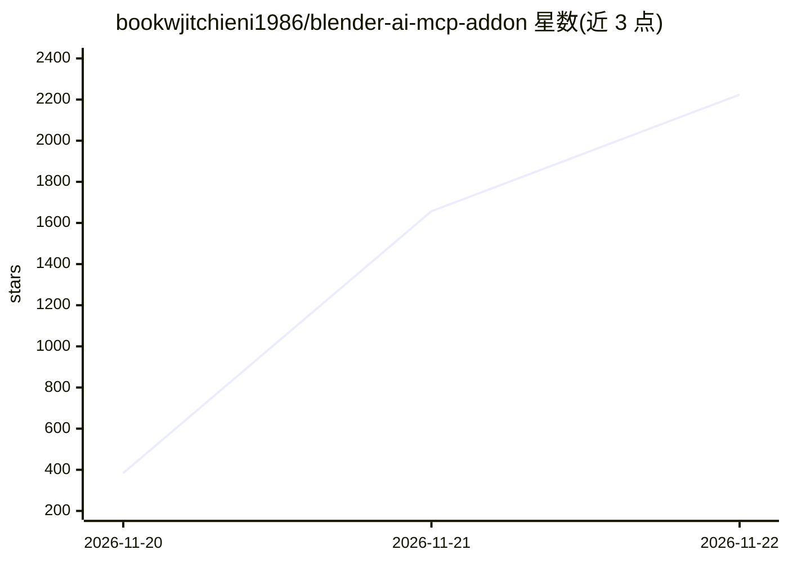

# bookwjitchieni1986/blender-ai-mcp-addon

⭐ 2,224 · MIT · 推送 2026-11-19 · [GitHub](https://github.com/bookwjitchieni1986/blender-ai-mcp-addon) · 个人维护

**Blender 的 AI 助手插件：对话式检查、构建与编辑 3D 场景**

以 Blender 4.2+ 插件形式发布的 AI 助手，可检查场景与对象、创建物体、编辑材质、搜索资产并执行多步工作流，配有带视口预览的可视化聊天窗口和内置 MCP 服务器（认证 Streamable HTTP）。支持单助手与 Manager/Worker/Reviewer 多代理链式任务，提供 21 个场景工具、操作审批、命名撤销步骤与 Python 工具校验（非安全沙箱）。支持 OpenAI、Anthropic、Gemini、OpenRouter、Ollama 及自定义端点。仅支持 Windows x64。

## 筛选速览

| 维度 | 判定 | 备注 |
|---|---|---|
| AI 角色 | `ai-native` | 本体是模型或模型工具 |
| 许可风险 | `permissive` | MIT |
| 部署形态 | `desktop` | 安装包/桌面程序 |
| 模型依赖 | local-ok | 支持本地模型 |
| 硬件要求 | — | 无带数字的原话,不猜 |
| 安装摩擦 | `low` | 无编译、无系统依赖或容器化 |
| 成熟度 | — | 结构信号不足 |

## 能力要点

- 21 个场景工具：创建、检查、编辑、截屏、资产搜索、bpy API 查询与导出
- Manager/Worker/Reviewer 多代理工作流，任务顺序执行与审批
- 内置 MCP 服务器，OpenCode 等 MCP 客户端可接入
- Poly Haven、Sketchfab、Poly Pizza 资产集成与中/英/德/法/西多语言界面

## 适用场景

- 通过对话让 AI 检查场景、布置产品展示并指定材质
- 用多代理团队拆分并执行大型场景搭建任务
- 通过 OpenCode 等 MCP 客户端从外部控制 Blender
- 自然语言搜索并导入 Poly Haven 等平台资产

## 场景标签

`AI 助手` `多智能体` · 领域:Agent 开发

## 证据(README 行号)

> L5: **An AI assistant for Blender that can inspect your scene, build objects, edit materials, find assets and carry out 
> L20: **mcp-for-blender-pro brings conversation, scene tools, model choice and agent workflows together.** It is designed
> L49: Supported connections include **OpenAI, Anthropic Claude, Google Gemini, OpenRouter, OpenCode Zen, Ollama and custo

## 星数曲线

2026-11-20 384 → 2026-11-22 2,224（+1,840）

---
*卡片 v1 · prompt 1.4 · 生成 2026-11-20 · 置信度 high · 依据 README sha `9c2ddc395401` · [字段定义](../../DATASET.md)*
