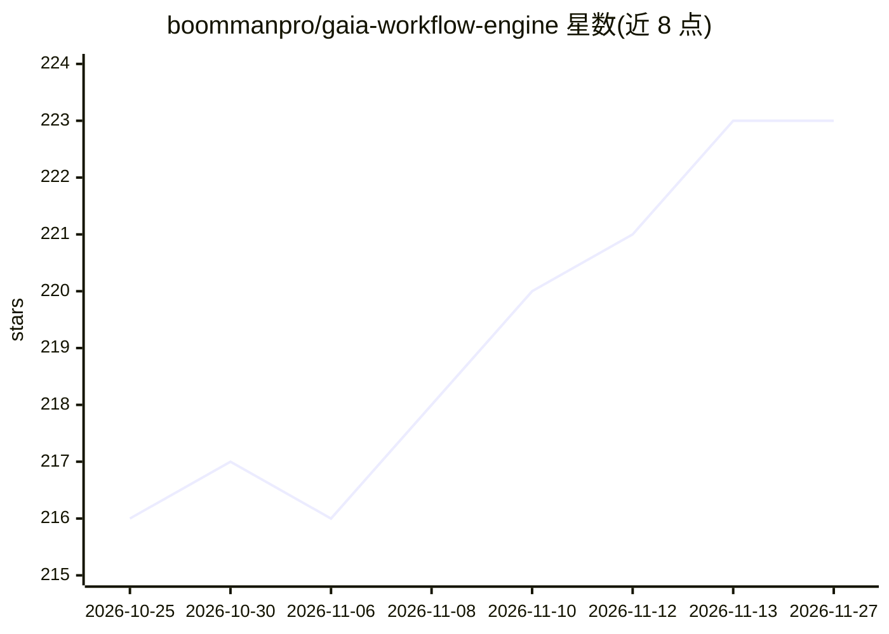

# boommanpro/gaia-workflow-engine

⭐ 223 · Java · MIT · 推送 2026-11-21 · [GitHub](https://github.com/boommanpro/gaia-workflow-engine) · [官网](https://boommanpro.github.io/gaia-workflow-engine/) · 个人维护 · 中文 README

**可视化画布编排 AI 工作流的规则引擎平台**

基于 flowgram.ai 前端与 Spring Boot + SQLite 后端的可视化 AI 工作流平台：在无限画布上拖拽编排 LLM 调用、条件分支、循环、HTTP 请求、代码执行等节点，并支持在侧栏对话中由 AI 分步规划、自动创建节点与连线。内置节点单测与整流试运行、版本 diff、运行观测 API。执行引擎可切换内置 AgentScope 或火山方舟托管 Agent，另提供 MCP 接口供外部 Coding Agent 构建工作流。面向需要编排 AI 流程的开发者与团队。

## 筛选速览

| 维度 | 判定 | 备注 |
|---|---|---|
| AI 角色 | `ai-ecosystem` | LLM/agent 周边工具 |
| 许可风险 | `permissive` | MIT |
| 部署形态 | `desktop` | 安装包/桌面程序 |
| 模型依赖 | local-ok | 支持本地模型 |
| 硬件要求 | — | 无带数字的原话,不猜 |
| 安装摩擦 | `low` | 无编译、无系统依赖或容器化 |
| 成熟度 | — | 结构信号不足 |

## 能力要点

- 无限画布拖拽编排：LLM 调用、条件分支、循环、HTTP、代码执行节点
- 侧栏对话生成工作流：CreatePlan 分步规划，Canvas 工具自动建节点连线
- 执行引擎可切换：内置 AgentScope 或火山方舟 Managed Agents
- MCP 接入外部 Coding Agent（DeepSeek、Claude Code 等），画布实时增量渲染

## 适用场景

- 不写代码在画布上编排 LLM 工作流并试运行
- 通过对话让 AI 自动生成并调试工作流
- 用 Claude Code 等 MCP 客户端远程构建工作流草稿
- 中小规模场景以单 jar 或 Docker Compose 部署工作流服务

## 场景标签

`工作流自动化` `编码 Agent` · 领域:效率与自动化

## 证据(README 行号)

> L5: 可视化 AI 工作流编辑器
> L16: 在无限画布上拖拽编排 AI 工作流：LLM 调用、条件分支、循环、HTTP 请求、代码执行。也可以在侧栏对话里描述需求，由 AI 规划步骤、自动创建节点和连线，直接在画布上试运行。
> L58: - 执行引擎可切换：内置 AgentScope，或火山方舟 Managed Agents

## 星数曲线

2026-10-25 216 → 2026-11-27 223（+7）

---
*卡片 v1 · prompt 1.4 · 生成 2026-11-25 · 置信度 high · 依据 README sha `541a4e88b345` · [字段定义](../../DATASET.md)*
