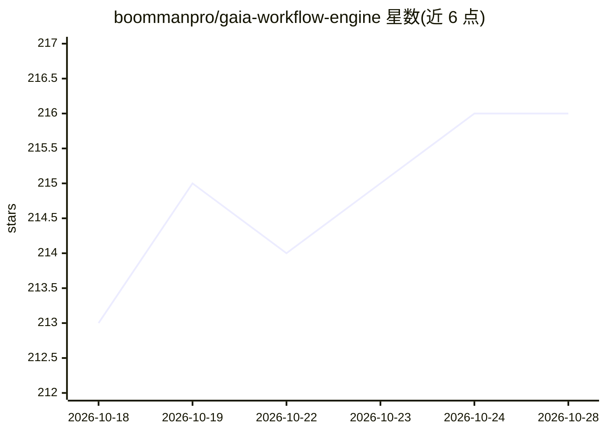

# boommanpro/gaia-workflow-engine

⭐ 216 · Java · MIT · 推送 2026-10-28 · [GitHub](https://github.com/boommanpro/gaia-workflow-engine) · [官网](https://boommanpro.github.io/gaia-workflow-engine/) · 个人维护 · 中文 README

**可视化 AI 工作流编排平台：画布设计、Agent 对话生成流程**

基于 flowgram.ai 前端与 Spring Boot Java 后端的可视化工作流引擎：在无限画布上拖拽节点设计含 LLM 调用、代码执行、HTTP 请求节点的工作流，支持实时预览、版本回滚与模板复用。侧栏 AI Agent 可对话式生成工作流（CreatePlan 分步规划、自动建节点连线），并管理端提供执行追踪与配置中心。LLM 接入需 OpenAI 兼容端点（vLLM/Ollama/LM Studio 均可），执行引擎可切换内置 AgentScope 或火山方舟托管。Docker 官方镜像暂未提供，需前后端分别构建运行。

## 筛选速览

| 维度 | 判定 | 备注 |
|---|---|---|
| AI 角色 | `ai-ecosystem` | LLM/agent 周边工具 |
| 许可风险 | `permissive` | MIT |
| 部署形态 | `library` | 以包/库形式分发 |
| 模型依赖 | local-ok | 支持本地模型 |
| 硬件要求 | — | 无带数字的原话,不猜 |
| 安装摩擦 | `medium` | 含编译或系统依赖之一 |
| 成熟度 | — | 结构信号不足 |

## 能力要点

- 无限画布 + 循环/分支/条件节点编排 AI 工作流
- 对话式 Agent 生成工作流（CreatePlan 规划 + 自动创建节点连线）
- 版本管理（保存即版本、一键回滚）与执行追踪（Token 账本、逐步时间线）
- 执行引擎可切换：内置 AgentScope / 火山方舟托管

## 适用场景

- 在可视化画布上编排和测试含 LLM 节点的工作流，无需写代码
- 通过对话让 Agent 自动生成并逐步执行工作流
- 在管理端追踪工作流执行过程与 Token 消耗

## 场景标签

`工作流自动化` `Agent 框架` · 领域:Agent 开发

## 证据(README 行号)

> L14: 一个现代化的可视化规则引擎平台，用于编排复杂的 AI 工作流。在无限画布上设计、测试和部署 AI 流程——无需编写代码。结合 flowgram.ai 的能力与 Java 服务端，提供生产级工作流管理。
> L18: - **AI Agent 侧栏对话** — 对话式生成工作流：CreatePlan 分步规划、Canvas 自动创建节点/连线、HTTP/Query 查询工作流、实时预览 token 与计划进度；会话可重命名、可审查。
> L98: Agent 对话需要一个 OpenAI 兼容的 LLM 端点（vLLM / Ollama / LM Studio / 各类网关均可）。启动后在浏览器进入 **管理 → 配置 → 模型配置**，填写 API Host / API K

## 星数曲线

2026-10-18 213 → 2026-10-28 216（+3）

---
*卡片 v1 · prompt 1.4 · 生成 2026-10-22 · 置信度 high · 依据 README sha `31bcf934a965` · [字段定义](../../DATASET.md)*
