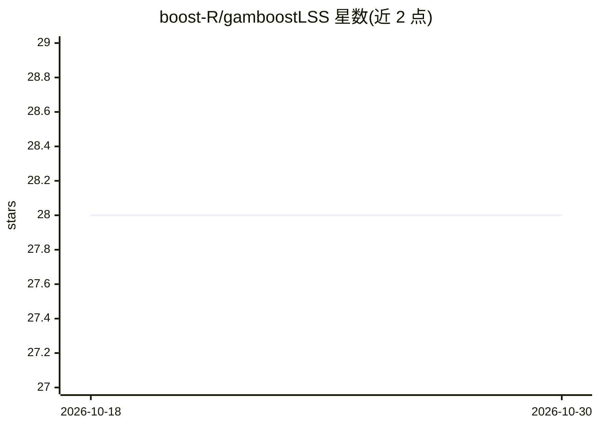

# boost-R/gamboostLSS

⭐ 28 · R · 推送 2026-09-17 · [GitHub](https://github.com/boost-R/gamboostLSS) · 组织维护

**R 包：用梯度提升拟合 GAMLSS 分布回归模型**

gamboostLSS 是一个 R 语言包，实现基于梯度提升的算法，用于拟合广义线性、加性与交互模型，面向可能高维的数据。与仅建模均值的做法不同，它支持同时对位置、尺度、形状等多个分布参数建模（即 GAMLSS）。提供非循环拟合方法相关论文引用，含教程。安装途径为 CRAN 的 install.packages，或经 devtools 从 GitHub 安装补丁版与开发版。

## 筛选速览

| 维度 | 判定 | 备注 |
|---|---|---|
| AI 角色 | `ai-native` | 本体是模型或模型工具 |
| 许可风险 | `none` | — |
| 部署形态 | `None` |  |
| 模型依赖 | — | README 未给出锁定关系 |
| 硬件要求 | — | 无带数字的原话,不猜 |
| 安装摩擦 | `low` | 无编译、无系统依赖或容器化 |
| 成熟度 | — | 结构信号不足 |

## 能力要点

- 提升算法拟合广义线性/加性/交互模型，面向高维数据
- 同时建模位置、尺度、形状等多个分布参数（GAMLSS）
- 支持从 CRAN 与 GitHub 安装（补丁版/开发版）
- 提供非循环拟合方法的论文（Statistics and Computing, 2018）

## 适用场景

- 对高维数据做分布回归建模
- 同时建模均值以外的分布参数（尺度/形状）
- 在 R 工作流中做基于提升的变量选择

## 场景标签

 · 领域:统计学习/机器学习

## 证据(README 行号)

> L8: `gamboostLSS` implements boosting algorithms for fitting generalized linear,
> L10: Instead of modeling only the mean, `gamboostLSS` enables the user to model

## 星数曲线

2026-10-18 28 → 2026-10-30 28（+0）

---
*卡片 v1 · prompt 1.4 · 生成 2026-10-26 · 置信度 high · 依据 README sha `334b6247dadf` · [字段定义](../../DATASET.md)*
