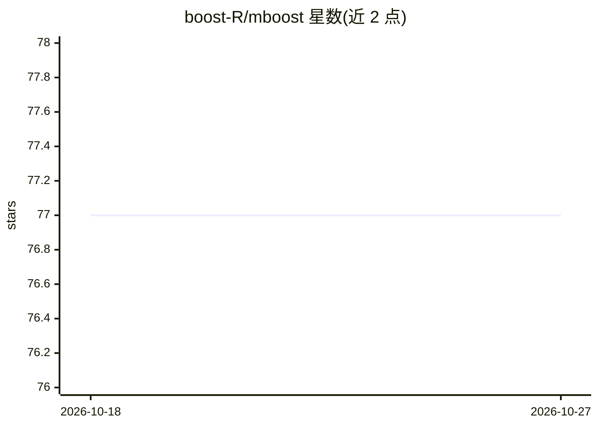

# boost-R/mboost

⭐ 77 · HTML · 推送 2026-09-22 · [GitHub](https://github.com/boost-R/mboost) · 组织维护

**R 包：用 boosting 拟合广义线性/可加/交互模型**

mboost 是一个 R 语言包，实现 boosting 算法，用于拟合广义线性模型、可加模型和交互模型，适用于可能的高维数据。面向统计建模与机器学习方向的 R 用户，主题标签显示其覆盖 GAM、GLM 与变量选择等建模任务。安装途径包括从 CRAN 安装当前版本，或通过 devtools 从 GitHub 安装补丁版与开发版（均标注 under development）。使用文档以教程形式提供，包括 mboost tutorial 与 mboost 2.0 教程，问题反馈走 GitHub Issues。

## 筛选速览

| 维度 | 判定 | 备注 |
|---|---|---|
| AI 角色 | `ai-native` | 本体是模型或模型工具 |
| 许可风险 | `none` | — |
| 部署形态 | `None` |  |
| 模型依赖 | — | README 未给出锁定关系 |
| 硬件要求 | — | 无带数字的原话,不猜 |
| 安装摩擦 | `low` | 无编译、无系统依赖或容器化 |
| 成熟度 | — | 结构信号不足 |

## 能力要点

- 实现 boosting 算法拟合广义线性/可加/交互模型
- 面向可能的高维数据建模
- 提供 CRAN 与 GitHub（补丁版/开发版）三种安装途径
- 配套教程（mboost tutorial、mboost 2.0）

## 适用场景

- 在 R 中用 boosting 拟合高维广义线性或可加模型
- 进行含变量选择的统计建模
- 通过教程学习 boosting 建模方法

## 场景标签

 · 领域:统计建模/机器学习

## 证据(README 行号)

> L8: `mboost` implements boosting algorithms for fitting generalized linear, additive and interaction models
> L9: to potentially high-dimensional data.

## 星数曲线

2026-10-18 77 → 2026-10-27 77（+0）

---
*卡片 v1 · prompt 1.4 · 生成 2026-10-24 · 置信度 high · 依据 README sha `daa1e631a7d2` · [字段定义](../../DATASET.md)*
