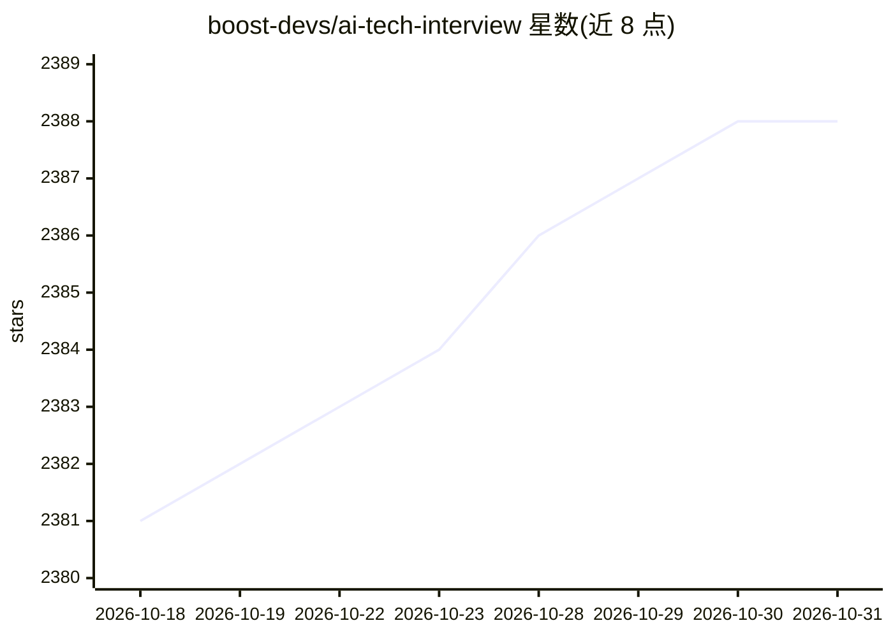

# boost-devs/ai-tech-interview

⭐ 2,388 · MIT · 推送 2026-03-17 · [GitHub](https://github.com/boost-devs/ai-tech-interview) · [官网](https://boostdevs.gitbook.io/ai-tech-interview/) · 组织维护

**韩语 AI 工程师技术面试题清单（统计/ML/DL/Python 等 7 类）**

面向 AI 工程师求职者的技术面试问题合集，按统计学/数学、机器学习、深度学习、Python、网络、操作系统、数据结构与算法分类组织，以问答条目形式罗列。内容由社区通过 Pull Request 提交并遵循编写规则，另可通过 GitBook 站点阅读，并链接第三方提供的面试练习工具。属于知识清单类仓库，不提供代码运行或安装。

## 筛选速览

| 维度 | 判定 | 备注 |
|---|---|---|
| AI 角色 | `ai-knowledge` | 知识聚合/清单类 |
| 许可风险 | `permissive` | MIT |
| 部署形态 | `None` |  |
| 模型依赖 | — | README 未给出锁定关系 |
| 硬件要求 | — | 无带数字的原话,不猜 |
| 安装摩擦 | `low` | 无编译、无系统依赖或容器化 |
| 成熟度 | — | 结构信号不足 |

## 能力要点

- 覆盖统计/ML/DL/Python/网络/OS/算法等 7 大类面试题
- 社区通过 Pull Request 协作贡献内容
- 提供 GitBook 在线阅读版本
- 参考并聚合了多个既有面试题仓库

## 适用场景

- 准备 AI 工程师岗位的技术面试
- 系统梳理机器学习与深度学习知识点
- 学习小组用作面试题讨论素材

## 场景标签

`教程课程` · 领域:学习与行业

## 证据(README 行号)

> L19: ## Interview Questions
> L21:  📈 통계/수학

## 星数曲线

2026-10-18 2,381 → 2026-10-31 2,388（+7）

---
*卡片 v1 · prompt 1.4 · 生成 2026-10-21 · 置信度 high · 依据 README sha `3c576817ac1a` · [字段定义](../../DATASET.md)*
