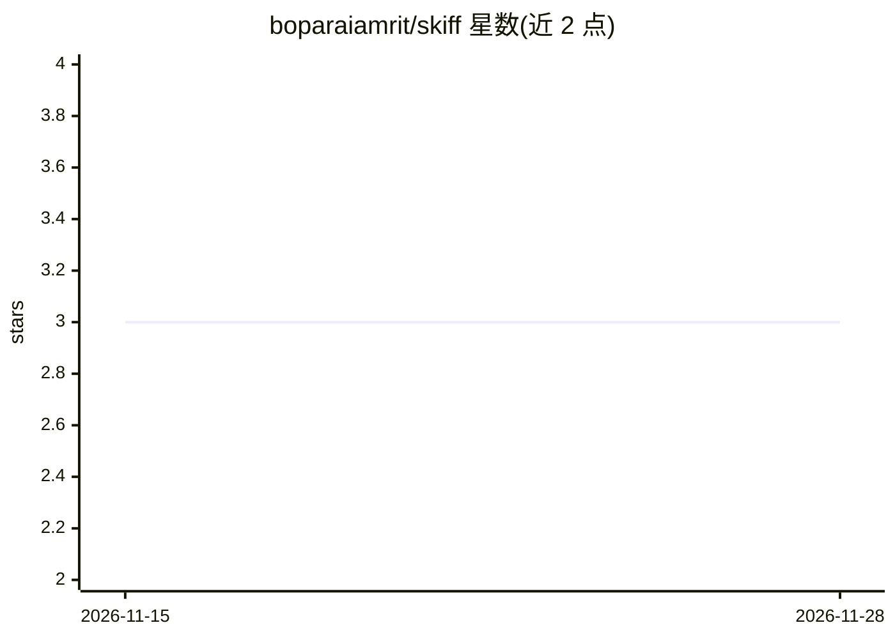

# boparaiamrit/skiff

⭐ 3 · JavaScript · Apache-2.0 · 推送 2026-11-15 · [GitHub](https://github.com/boparaiamrit/skiff) · [官网](https://boparaiamrit.github.io/skiff/) · 个人维护

**在 Android 手机运行官方 Claude Code 的移动客户端**

在 Android 手机上通过 proot 运行 Ubuntu 24.04 并安装官方 Claude Code，提供触摸优先的聊天界面（流式输出、工具卡片、diff、Allow/Deny）、终端、文件管理、预览面板与 GitHub 操作。无障碍服务驱动的手机控制让 Claude 读取屏幕并执行点击、输入、打开应用等操作；侧边按钮助手可替换 Gemini，支持语音交互。架构上由 Java Android 应用、Go 的 skiffd 本地 API 与 MCP 工具服务器、Preact UI 组成。需 Android 11+ arm64，需自备 Claude 订阅。

## 筛选速览

| 维度 | 判定 | 备注 |
|---|---|---|
| AI 角色 | `ai-native` | 本体是模型或模型工具 |
| 许可风险 | `permissive` | Apache-2.0 |
| 部署形态 | `library` | 以包/库形式分发 |
| 模型依赖 | — | README 未给出锁定关系 |
| 硬件要求 | — | 无带数字的原话,不猜 |
| 安装摩擦 | `medium` | 含编译或系统依赖之一 |
| 成熟度 | — | 结构信号不足 |

## 能力要点

- proot 运行 Ubuntu 24.04 并安装 Anthropic 官方 Claude Code，登录凭据不经应用
- 聊天界面含流式回答、工具卡片、inline diff 与 Allow/Deny 权限卡片
- 通过 MCP 服务器与无障碍服务实现手机控制，高风险操作需屏幕确认
- 侧键语音助手支持设备端或 Whisper 语音识别

## 适用场景

- 在手机上运行 Claude Code 进行编码任务
- 让 AI 代为操作手机（回消息、整理页面、设闹钟）
- 长按侧键在任意应用上语音问答
- 手机终端管理文件与克隆 GitHub 仓库

## 场景标签

`编码 Agent` `AI 助手` · 领域:编码与开发

## 证据(README 行号)

> L10:  Skiff puts a real Ubuntu on your Android phone, installs the official Claude Code inside it,
> L65:  Skiff app talks to skiffd over a token-protected local API; skiffd runs Claude Code in Ubuntu and gives it phone t
> L68: * **Chat** drives Claude Code's documented stream-json mode. Permission prompts arrive through a small MCP server a

## 星数曲线

2026-11-15 3 → 2026-11-28 3（+0）

---
*卡片 v1 · prompt 1.4 · 生成 2026-11-22 · 置信度 high · 依据 README sha `f83db24c6be2` · [字段定义](../../DATASET.md)*
