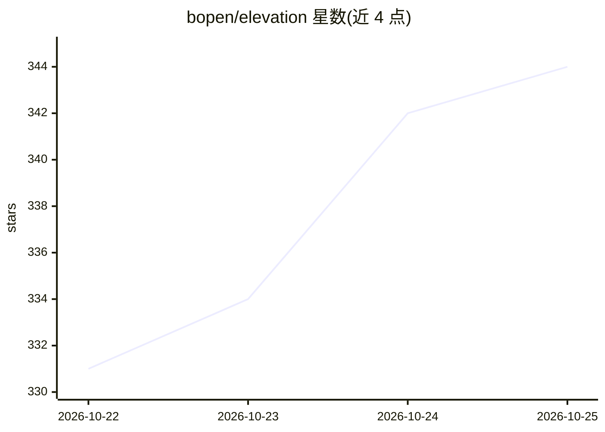

# bopen/elevation

⭐ 344 · Python · Apache-2.0 · 推送 2026-10-24 · [GitHub](https://github.com/bopen/elevation) · [官网](http://elevation.bopen.eu) · 组织维护

**全球 DEM 数据下载/缓存/裁剪的 Python 工具与 CLI**

提供全球数字高程模型（DEM）的下载、本地缓存与按区域裁剪，覆盖 Mapzen Terrain Tiles、Copernicus GLO-30/GLO-90、ALOS World 3D、SRTM 30m/90m 等 7 种数据集。以 pip 安装的 Python 包提供，含 `eio` 命令行（clip/seed/dataset/info 等）与等价 Python API；依赖 GDAL 命令行工具（GLO 产品需 GDAL 3.8+ 并配置 Earth Data Hub 凭据）。默认单次限下 25 个瓦片以防批量下载；目标平台 Linux/macOS，Windows 仅轻度测试。

## 筛选速览

| 维度 | 判定 | 备注 |
|---|---|---|
| AI 角色 | `ai-knowledge` | 知识聚合/清单类 |
| 许可风险 | `permissive` | Apache-2.0 |
| 部署形态 | `library` | 以包/库形式分发 |
| 模型依赖 | — | README 未给出锁定关系 |
| 硬件要求 | — | 无带数字的原话,不猜 |
| 安装摩擦 | `medium` | 含编译或系统依赖之一 |
| 成熟度 | — | 结构信号不足 |

## 能力要点

- 支持 7 种全球 DEM 数据集（Mapzen/Copernicus/AW3D30/SRTM 等）
- eio CLI 与 Python API 双形态，GeoTIFF 压缩缓存加速后续访问
- --reference 可按任意 GDAL/OGR 支持的栅格或矢量数据范围裁剪
- GLO-30/GLO-90 以 Zarr 云端按块读取替代整瓦片下载

## 适用场景

- 按经纬度范围获取某区域的 30m/90m 高程数据
- 为已配准影像或矢量范围裁剪对应 DEM
- 批量预处理高程瓦片到本地缓存供后续使用

## 场景标签

 · 领域:地理空间/遥感数据

## 证据(README 行号)

> L8: Elevation provides easy download, cache and access of the global datasets:
> L10: - `MAPZEN`: Terrain Tiles global 30m v1

## 星数曲线

2026-10-22 331 → 2026-10-25 344（+13）

---
*卡片 v1 · prompt 1.4 · 生成 2026-10-21 · 置信度 high · 依据 README sha `4d307b01967d` · [字段定义](../../DATASET.md)*
