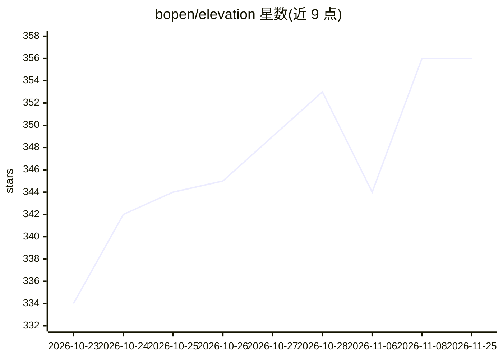

# bopen/elevation

⭐ 356 · Python · Apache-2.0 · 推送 2026-11-15 · [GitHub](https://github.com/bopen/elevation) · [官网](http://elevation.bopen.eu) · 组织维护

**给 GIS/遥感用户下载、缓存并裁剪全球地形 DEM 数据**

elevation 是一个 Python 库与命令行工具（eio），提供对多套全球数字高程模型的下载、缓存与按地理范围裁剪：Mapzen Terrain Tiles、Copernicus DEM GLO-30/GLO-90、ALOS World 3D、GEDTM30、SRTM 30m/90m 等 8 个数据集。关键机制包括按需分块缓存、--reference 按已有栅格/矢量裁剪、STAC 元数据查看与缓存管理子命令；限制方面依赖 GDAL 命令行工具，读取云端存储需 GDAL 3.8+，需 Python 3.11+，且部分数据源需账号凭据，各数据提供方的下载政策与署名要求仍适用。

## 筛选速览

| 维度 | 判定 | 备注 |
|---|---|---|
| AI 角色 | `ai-native` | 本体是模型或模型工具 |
| 许可风险 | `permissive` | Apache-2.0 |
| 部署形态 | `library` | 以包/库形式分发 |
| 模型依赖 | — | README 未给出锁定关系 |
| 硬件要求 | — | 无带数字的原话,不猜 |
| 安装摩擦 | `medium` | 含编译或系统依赖之一 |
| 成熟度 | — | 结构信号不足 |

## 能力要点

- 支持 8 个全球 DEM 数据集（Mapzen、Copernicus GLO-30/GLO-90、AW3D30、GEDTM30、SRTM 30m/90m）
- 按地理 bounds 或 --reference 栅格/矢量裁剪输出 GeoTIFF
- 分块缓存机制，同区域重复访问更快；max_download_tiles 限制防止批量下载
- 提供 eio 命令行与 Python API 双入口及 STAC 元数据查看

## 适用场景

- 为机器学习或 GIS 分析项目获取指定范围的 DEM 栅格
- 按已有影像或矢量范围裁剪对应高程数据
- 为多个全球 DEM 数据源建立本地缓存以加速重复访问

## 场景标签

 · 领域:地理空间/遥感数据处理

## 证据(README 行号)

> L8: Elevation provides easy download, cache and access of the global datasets:
> L41: ## Installation
> L76: Identify the geographic bounds of the area of interest and fetch the DEM with the `eio` command.

## 星数曲线

2026-10-23 334 → 2026-11-25 356（+22）

---
*卡片 v1 · prompt 1.4 · 生成 2026-11-25 · 置信度 high · 依据 README sha `7516340e9037` · [字段定义](../../DATASET.md)*
