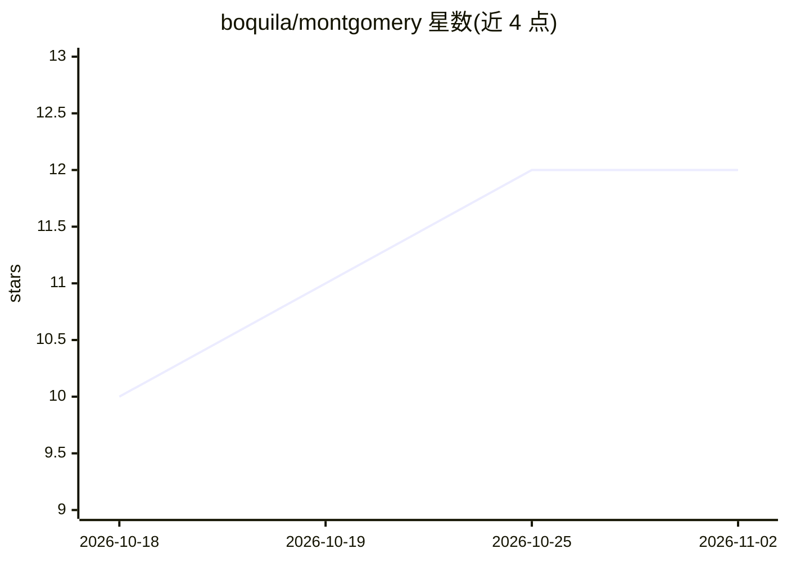

# boquila/montgomery

⭐ 12 · Rust · AGPL-3.0 · 推送 2026-10-29 · [GitHub](https://github.com/boquila/montgomery) · 组织维护

**Rust 计算机视觉推理与训练栈，CPU/GPU 运行**

基于 Burn 框架的 Rust 计算机视觉栈，提供检测、实例分割、语义分割、深度估计与分类五类任务的推理和 WGPU 训练，推理无需 Python、PyTorch 或 ONNX Runtime。支持 YOLOX/YOLOv8/v10/11/12/26 等模型系列，CLI 覆盖数据集检查与转换、训练（含可恢复检查点）、验证、ONNX 导出与基准测试。自称 experimental，开发仅需 Stable Rust。

## 筛选速览

| 维度 | 判定 | 备注 |
|---|---|---|
| AI 角色 | `ai-native` | 本体是模型或模型工具 |
| 许可风险 | `viral` | AGPL-3.0 |
| 部署形态 | `None` |  |
| 模型依赖 | — | README 未给出锁定关系 |
| 硬件要求 | — | 无带数字的原话,不猜 |
| 安装摩擦 | `low` | 无编译、无系统依赖或容器化 |
| 成熟度 | `idea` | |

## 能力要点

- 五种视觉任务的原生 Rust 推理，无需 Python/PyTorch
- WGPU 训练：验证、可恢复检查点、自动 microbatch 探测
- Burnpack 与 ONNX 导出，导出时用 ONNX Runtime 校验图
- 纯 Rust 的数据集检查与格式转换（YOLO/COCO/class-folder）

## 适用场景

- 在 CPU 或 GPU 上对 YOLO 系列模型做检测/分割/深度估计推理
- 用 Rust 工具链完成从数据准备到训练、导出 ONNX 的完整流程
- 检查数据集的类别均衡、缺失标注与切分泄漏

## 场景标签

`目标检测` `图像视频处理` `推理引擎` · 领域:感知与多模态

## 证据(README 行号)

> L3: Native object detection, instance segmentation, semantic segmentation, depth estimation, and image classification in
> L12: - Computer vision inference on CPU or GPU
> L14: - Detection, instance segmentation, semantic segmentation, depth estimation, and classification

## 星数曲线

2026-10-18 10 → 2026-11-02 12（+2）

---
*卡片 v1 · prompt 1.4 · 生成 2026-11-01 · 置信度 high · 依据 README sha `c4798eadea5d` · [字段定义](../../DATASET.md)*
