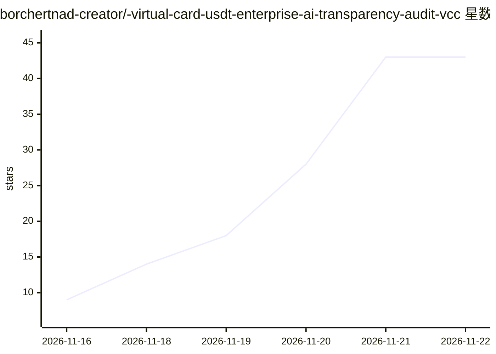

# borchertnad-creator/-virtual-card-usdt-enterprise-ai-transparency-audit-vcc

⭐ 43 · 推送 2026-11-16 · [GitHub](https://github.com/borchertnad-creator/-virtual-card-usdt-enterprise-ai-transparency-audit-vcc) · [官网](https://app.coregold.io/signup?invite_code=ADvlj9b) · 组织维护 · 中文 README

**推广 CoreGold 商业虚拟卡（VCC）+USDT 的营销文稿仓库**

仓库内容为一篇中文营销文案，借'前沿模型透明度新规与预算审计'的行业叙事，推广 CoreGold 商业虚拟卡平台：企业以 USDT（TRC20/ERC20）充值资金池，按部门签发独立美国商业 VCC，支持 Apple Pay 绑定、月度限额与一键销毁回收，用于替代个人卡垫付和代充支付海外 AI/SaaS 订阅。README 不含任何可安装的软件、代码或 API，仅提供控制台入口与一段十六进制字符串（疑似推广标识）。

## 筛选速览

| 维度 | 判定 | 备注 |
|---|---|---|
| AI 角色 | `ai-enhanced` | 去掉 AI 部分产品仍成立 |
| 许可风险 | `none` | — |
| 部署形态 | `None` |  |
| 模型依赖 | — | README 未给出锁定关系 |
| 硬件要求 | — | 无带数字的原话,不猜 |
| 安装摩擦 | `low` | 无编译、无系统依赖或容器化 |
| 成熟度 | — | 结构信号不足 |

## 能力要点

- USDT（TRC20/ERC20）充值折算 USD 资金池，链上哈希可追溯
- 按部门签发独立商业 VCC，自带 AVS 账单地址与月度硬限额
- 支持 Apple Pay 绑定 Apple Wallet（DPAN），卡片可一键注销退回母池

## 适用场景

- 出海团队用商业虚拟卡集中支付海外 AI/SaaS 订阅
- 按部门/项目归集账单流水用于财务审计

## 场景标签

 · 领域:企业支付/金融服务推广

## 证据(README 行号)

> L7: 当你的公司同时订阅了 **ChatGPT Enterprise/Team**、**Claude Fable 5.2**、**Google Cloud** 以及十余个海外开发 SaaS 时，你需要一套**清晰可溯源、权限物理隔离、且能
> L18: - **USDT 链上注资，资金链路全透明**：企业财务在 CoreGold 官方控制台 通过 **USDT（TRC20/ERC20）** 集中充值，链上哈希每一笔都可追溯审计，秒级折算为 USD 资金池，彻底告别繁琐的跨境电汇审

## 星数曲线

2026-11-16 9 → 2026-11-22 43（+34）

---
*卡片 v1 · prompt 1.4 · 生成 2026-11-18 · 置信度 low · 依据 README sha `c846528d48e8` · [字段定义](../../DATASET.md)*
