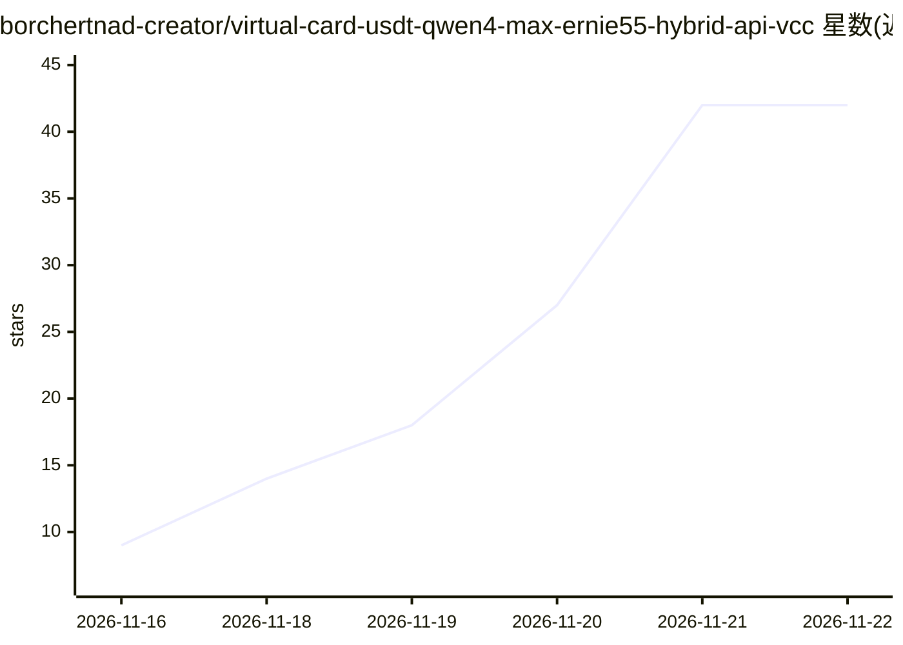

# borchertnad-creator/virtual-card-usdt-qwen4-max-ernie55-hybrid-api-vcc

⭐ 42 · 推送 2026-11-16 · [GitHub](https://github.com/borchertnad-creator/virtual-card-usdt-qwen4-max-ernie55-hybrid-api-vcc) · [官网](https://app.coregold.io/signup?invite_code=ADvlj9b) · 组织维护 · 中文 README

**面向出海 AI 开发者的虚拟卡（VCC）支付服务推广文**

README 以混合路由网关（国产开源模型为主力、ChatGPT/Claude 兜底）的运维场景为切入，介绍 CoreGold 商业虚拟信用卡服务：为每个上游推理网关节点开独立美国商业卡段 VCC 配独立 AVS 地址，用 USDT（TRC20/ERC20）充值资金池秒转 USD，支持按卡设日/月消费限额、Apple Pay 绑定与销卡退款。内容为产品宣传与操作指引，仓库不含可安装代码。

## 筛选速览

| 维度 | 判定 | 备注 |
|---|---|---|
| AI 角色 | `ai-ecosystem` | LLM/agent 周边工具 |
| 许可风险 | `none` | — |
| 部署形态 | `None` |  |
| 模型依赖 | — | README 未给出锁定关系 |
| 硬件要求 | — | 无带数字的原话,不猜 |
| 安装摩擦 | `low` | 无编译、无系统依赖或容器化 |
| 成熟度 | — | 结构信号不足 |

## 能力要点

- 每路由节点一张独立 16 位美国商业卡段 VCC 与独立北美 AVS 地址
- USDT（TRC20/ERC20）充值资金池，秒转 USD，7×24 补给
- 支持 Apple Pay 绑定与按卡设定日/月消费硬限额

## 适用场景

- 为多家海外推理网关的上游账号配置支付隔离的独立虚拟卡
- 以 USDT 充值资金池为多张 VCC 自动补充余额
- 多账号轮询场景下避免共卡连坐封号

## 场景标签

 · 领域:支付服务/虚拟卡（面向 AI API 出海开发者）

## 证据(README 行号)

> L16: ### 二、 CoreGold 商业 VCC：专为多路由网关打造的“隔离卡池”
> L20: - **独立商业卡段，切断卡指纹关联**：在 CoreGold 后台为每个上游节点单独开卡（比如 `Route-OpenAI-Main`、`Route-OpenRouter-Qwen4`、`Route-Together-Backu
> L27: 1. **注入 USDT 蓄水池**：登录 CoreGold 官方控制台，进 **`资产管理`** 充入 **USDT**，秒级折算为 USD 总资金池。

## 星数曲线

2026-11-16 9 → 2026-11-22 42（+33）

---
*卡片 v1 · prompt 1.4 · 生成 2026-11-18 · 置信度 mid · 依据 README sha `5fee581d1698` · [字段定义](../../DATASET.md)*
