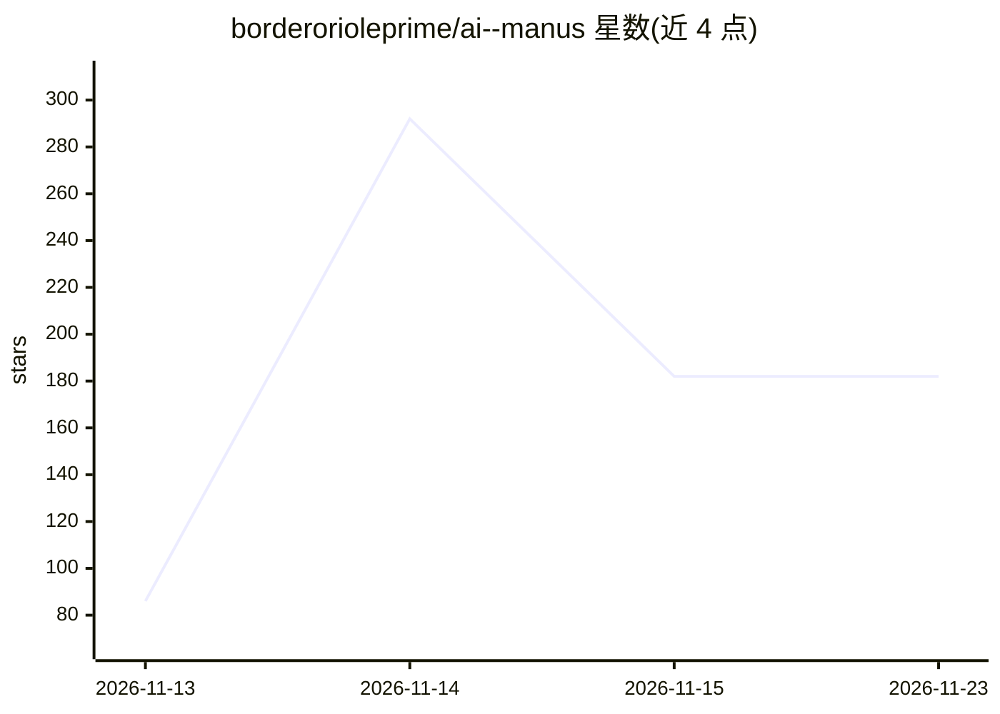

# borderorioleprime/ai--manus

⭐ 182 · Apache-2.0 · 推送 2026-11-15 · [GitHub](https://github.com/borderorioleprime/ai--manus) · 个人维护

**面向个人日常任务的自主 AI Agent：自动执行代码与浏览器操作**

README 描述一个自主 AI 代理，声称可代替用户编写并执行脚本、控制浏览器（导航网页、填写表单、抓取信息），并处理多步骤日常任务，面向学生、远程工作者与家庭/轻办公用户。文档给出兼容性表（双核 CPU、4 GB RAM 起）与使用步骤说明，但未给出任何具体的安装命令、技术架构、模型接入方式或代码内容；文末附大量搜索关键词。整体为营销式描述，可验证的技术事实有限。

## 筛选速览

| 维度 | 判定 | 备注 |
|---|---|---|
| AI 角色 | `ai-native` | 本体是模型或模型工具 |
| 许可风险 | `permissive` | Apache-2.0 |
| 部署形态 | `None` |  |
| 模型依赖 | — | README 未给出锁定关系 |
| 硬件要求 | — | 无带数字的原话,不猜 |
| 安装摩擦 | `low` | 无编译、无系统依赖或容器化 |
| 成熟度 | — | 结构信号不足 |

## 能力要点

- 声称支持自主代码执行与浏览器控制，可在脚本与浏览器操作间衔接完成多步骤任务
- 面向学习研究、家庭项目、轻办公与开发测试等小规模场景
- README 给出兼容性表：双核 CPU、4 GB RAM 最低、8 GB 推荐

## 适用场景

- 让代理代为执行重复性的脚本与网页操作
- 收集资料、整理笔记、跑快速计算
- 远程排障时让代理检查系统页面并整理诊断步骤

## 场景标签

`浏览器自动化` `编码 Agent` `AI 助手` · 领域:效率与自动化

## 证据(README 行号)

> L10: - **Autonomous Code Execution:** Manus AI agent runs code on its own to complete tasks, so you can focus on decisio
> L18: Manus is an autonomous AI agent designed to run code and control a browser on your behalf. Instead of acting like a

## 星数曲线

2026-11-13 86 → 2026-11-23 182（+96）

---
*卡片 v1 · prompt 1.4 · 生成 2026-11-17 · 置信度 low · 依据 README sha `0f78ee3a5dd2` · [字段定义](../../DATASET.md)*
