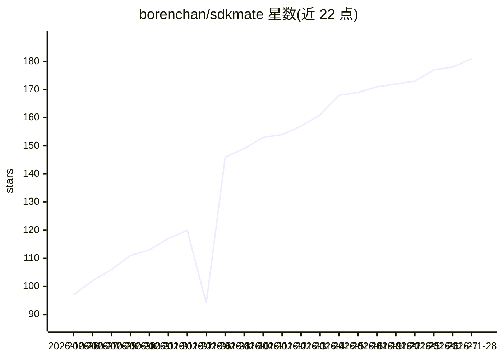

# borenchan/sdkmate

⭐ 181 · Rust · Apache-2.0 · 推送 2026-11-27 · [GitHub](https://github.com/borenchan/sdkmate) · 个人维护 · 中文 README

**全栈开发者的 Rust 跨平台 SDK 版本管理器，含桌面端与 AI Agent 技能**

纯 Rust 编写的跨平台 SDK 版本管理器，一条命令安装/切换 Java、Node.js、Python、Maven、Go 等 40+ 开发工具，定位替代多个单语言版本管理脚本的组合。机制上提供全局/项目/临时三种切换作用域（symlink+PATH、.sdkm.toml+shell hook、临时环境变量），失败自动回滚，CLI 为单二进制无运行时依赖。另附 Claude Code/Codex 可读取的 SKILL.md，让 AI Agent 代为执行安装与切换。Windows 需管理员终端执行 init/switch。

## 筛选速览

| 维度 | 判定 | 备注 |
|---|---|---|
| AI 角色 | `ai-enhanced` | 去掉 AI 部分产品仍成立 |
| 许可风险 | `permissive` | Apache-2.0 |
| 部署形态 | `desktop` | 安装包/桌面程序 |
| 模型依赖 | — | README 未给出锁定关系 |
| 硬件要求 | — | 无带数字的原话,不猜 |
| 安装摩擦 | `high` | 编译与系统依赖俱全 |
| 成熟度 | — | 结构信号不足 |

## 能力要点

- 单二进制 CLI（约 4MB）+ 基于 GPUI 的原生桌面端，共用同一 Rust 核心
- 全局/项目/临时三种版本切换作用域，进入目录自动切换、离开自动恢复
- 操作失败自动回滚，config 原子写入+快照恢复
- 内置 Agent 技能文档，Claude Code/Codex 读取后可代为安装/切换 SDK

## 适用场景

- 全栈开发中统一管理多语言 SDK 版本，替代多个单语言版本管理工具
- 项目目录固定 SDK 版本，团队进入目录自动生效
- 通过 Claude Code 等编码助手用自然语言管理本机开发环境
- 把 sdkm 目录拷入 U 盘在多台机器间携带 SDK 环境

## 场景标签

 · 领域:开发工具/环境管理

## 证据(README 行号)

> L22:  sdkmate (a.k.a. "时代楷模" 👀) is a pure-Rust , cross-platform SDK version manager with a native desktop app built on G
> L57:  🤖 AI Agent Friendly
> L70: - **🤖 AI-agent friendly, let AI manage your env**: ships with an agent skill doc — Claude Code / Codex / openclaw a

## 星数曲线

2026-10-26 97 → 2026-11-28 181（+84）

---
*卡片 v1 · prompt 1.4 · 生成 2026-11-26 · 置信度 high · 依据 README sha `fc9a9fc0c607` · [字段定义](../../DATASET.md)*
