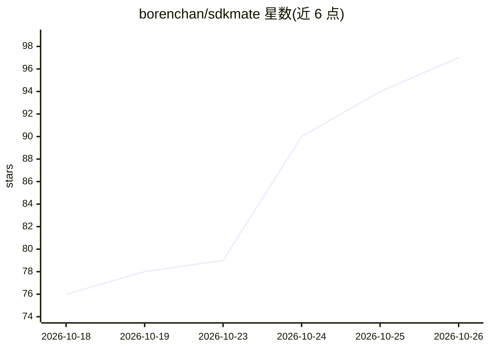

# borenchan/sdkmate

⭐ 97 · Rust · Apache-2.0 · 推送 2026-10-23 · [GitHub](https://github.com/borenchan/sdkmate) · 个人维护 · 中文 README

**跨平台 SDK 版本管理器：一条命令安装切换 40+ 开发工具版本**

用 Rust 编写的单二进制跨平台 SDK 版本管理器（sdkm），面向全栈开发者：安装与切换 Java、Node.js、Python、Maven、Go、uv、bun 等 40 余种开发工具版本，支持全局/项目（.sdkm.toml）/临时三种作用域切换与模糊版本匹配，操作带快照回滚，Windows/Linux/macOS 均为一等公民。单文件约 4MB、零运行时依赖，可放入已有 SDK 接管。附带 agent 技能文档（SKILL.md），供 Claude Code / Codex 等 AI 编码助手读取后代为安装切换 SDK，本体去掉该功能仍可独立使用。

## 筛选速览

| 维度 | 判定 | 备注 |
|---|---|---|
| AI 角色 | `ai-enhanced` | 去掉 AI 部分产品仍成立 |
| 许可风险 | `permissive` | Apache-2.0 |
| 部署形态 | `desktop` | 安装包/桌面程序 |
| 模型依赖 | — | README 未给出锁定关系 |
| 硬件要求 | — | 无带数字的原话,不猜 |
| 安装摩擦 | `high` | 编译与系统依赖俱全 |
| 成熟度 | — | 结构信号不足 |

## 能力要点

- 单 Rust 二进制约 4MB、零运行时依赖，可从 U 盘运行并接管已有 SDK
- 全局/项目/临时三作用域版本切换，切换失败自动回滚
- 内置 40+ SDK，任意 URL 可下载的工具可注册为自定义 SDK
- 附带 agent 技能文档，AI 助手可据退出码判断成败并代为操作

## 适用场景

- 在同一台机器上管理多个语言的 SDK 版本并按项目自动切换
- 让 Claude Code 等 AI 编码助手代为安装和切换开发环境
- 原生 Windows 环境下进行全局版本切换（WM_SETTINGCHANGE 广播）

## 场景标签

 · 领域:开发者工具/环境管理

## 证据(README 行号)

> L62:  🤖 AI Agent Friendly
> L75: - **🤖 AI-agent friendly, let AI manage your env**: ships with an agent skill doc — Claude Code / Codex / openclaw a
> L79: > It's 2026 — tired of too many CLI flags? Worried about the learning curve? Let an AI agent do it for you.

## 星数曲线

2026-10-18 76 → 2026-10-26 97（+21）

---
*卡片 v1 · prompt 1.4 · 生成 2026-10-23 · 置信度 high · 依据 README sha `2b8255965369` · [字段定义](../../DATASET.md)*
