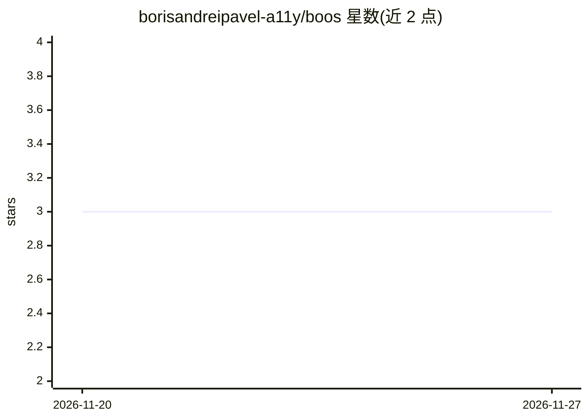

# borisandreipavel-a11y/boos

⭐ 3 · Python · Apache-2.0 · 推送 2026-11-25 · [GitHub](https://github.com/borisandreipavel-a11y/boos) · [官网](https://boosai.tech) · 个人维护

**模型按需编写应用的实验性 x86-64 Rust 操作系统**

从零用 Rust 编写的 x86-64 操作系统内核：无 bootloader，固件直接加载，自行管理内存、任务、键盘、屏幕、磁盘与网络（virtio/Intel 网卡、TLS）。应用不安装而是向模型请求：模型经 OrcaRouter 服务在线生成 Lua 脚本，内核在 WebAssembly 沙箱中带内存限额与步数预算运行，运行过的应用存盘可复用。可在 QEMU 与 VirtualBox 启动，未在真实硬件上运行过；构建脚本针对 Windows。

## 筛选速览

| 维度 | 判定 | 备注 |
|---|---|---|
| AI 角色 | `ai-native` | 本体是模型或模型工具 |
| 许可风险 | `permissive` | Apache-2.0 |
| 部署形态 | `desktop` | 安装包/桌面程序 |
| 模型依赖 | — | README 未给出锁定关系 |
| 硬件要求 | — | 无带数字的原话,不猜 |
| 安装摩擦 | `low` | 无编译、无系统依赖或容器化 |
| 成熟度 | `idea` | |

## 能力要点

- 模型在线编写 Lua 应用，内核内解释器运行
- WebAssembly 沙箱隔离：内存限额与 fuel 步数预算
- 内核自带 TLS 加密通信与证书校验
- 已运行的应用保留在磁盘并可再次执行

## 适用场景

- 体验无安装、按需生成应用的操作系统形态
- 研究内核与模型协作的架构设计
- 在 QEMU/VirtualBox 中试用实验性内核

## 场景标签

`代码生成` · 领域:编码与开发

## 证据(README 行号)

> L18: - **A model does the slow, clever work:** it writes the app you asked for. It is not part of the kernel. It is reac
> L54: - Sends every line typed in the chat box to a model, together with a short fixed text, a record of what was said be

## 星数曲线

2026-11-20 3 → 2026-11-27 3（+0）

---
*卡片 v1 · prompt 1.4 · 生成 2026-11-22 · 置信度 high · 依据 README sha `dc3879ebad67` · [字段定义](../../DATASET.md)*
