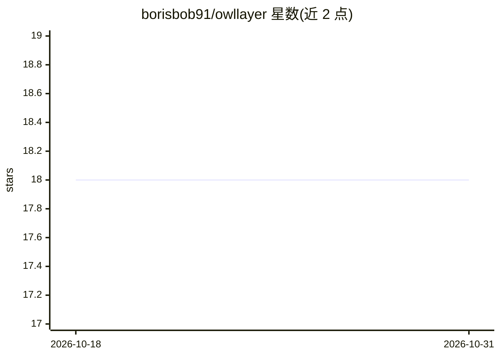

# borisbob91/owllayer

⭐ 18 · TypeScript · MIT · 推送 2026-10-11 · [GitHub](https://github.com/borisbob91/owllayer) · [官网](https://borisbob91.github.io/owllayer/) · 个人维护 · 中文 README

**TypeScript Agentic UI SDK：让 AI agent 通过页面工具驱动 Web/移动界面**

面向前端开发者的开源 TypeScript SDK，覆盖 React/Vue/Angular/Svelte/浏览器及 Flutter/Swift/Kotlin 等集成方式。核心机制是 Neural-DOM Binding：按钮、表单、组件注册为带输入 schema 与风险等级的工具，由应用自身的 handler 执行；Shadow Context 提供白名单化 UI 状态；AITP 协议同步上下文与调用；high/critical 操作内置 Human-in-the-Loop 审批。支持 OpenAI/Gemini/Claude 的 LLM 与工具调用，以及实时语音、STT/TTS、LiveKit 语音运行时。README 声明 Shopify/WooCommerce 插件为实验性。

## 筛选速览

| 维度 | 判定 | 备注 |
|---|---|---|
| AI 角色 | `ai-ecosystem` | LLM/agent 周边工具 |
| 许可风险 | `permissive` | MIT |
| 部署形态 | `library` | 以包/库形式分发 |
| 模型依赖 | locked-api |  |
| 硬件要求 | — | 无带数字的原话,不猜 |
| 安装摩擦 | `low` | 无编译、无系统依赖或容器化 |
| 成熟度 | `idea` | |

## 能力要点

- 界面元素声明为工具，由应用自身 handler 执行，不暴露 DOM
- high/critical 风险操作内置 Human-in-the-Loop 审批
- 支持 React/Vue/Svelte/Angular/浏览器及 Flutter/Swift/Kotlin 集成
- 支持 OpenAI/Gemini/Claude 工具调用与实时语音、STT/TTS、LiveKit

## 适用场景

- 在电商应用中让用户用语音或文字直接完成搜索、加购、结算
- 为企业仪表盘、客服流程构建受控的对话式操作界面
- 给现有多页面 Web 应用渐进式添加 agent 交互

## 场景标签

`Agent 框架` `GUI 自动化` · 领域:Agent 开发

## 证据(README 行号)

> L7:  OwlLayer AI is an open-source TypeScript Agentic UI SDK for building interfaces where actions are explicit, context
> L58: OwlLayer AI works **on the interface side**: it turns the elements of your web app (buttons, links, form fields, co
> L147: |**LLM and tool calling**|OpenAI Google Gemini Anthropic Claude|Text conversations, structured tool calls, and pro

## 星数曲线

2026-10-18 18 → 2026-10-31 18（+0）

---
*卡片 v1 · prompt 1.4 · 生成 2026-10-29 · 置信度 high · 依据 README sha `3d1ce741d8ca` · [字段定义](../../DATASET.md)*
