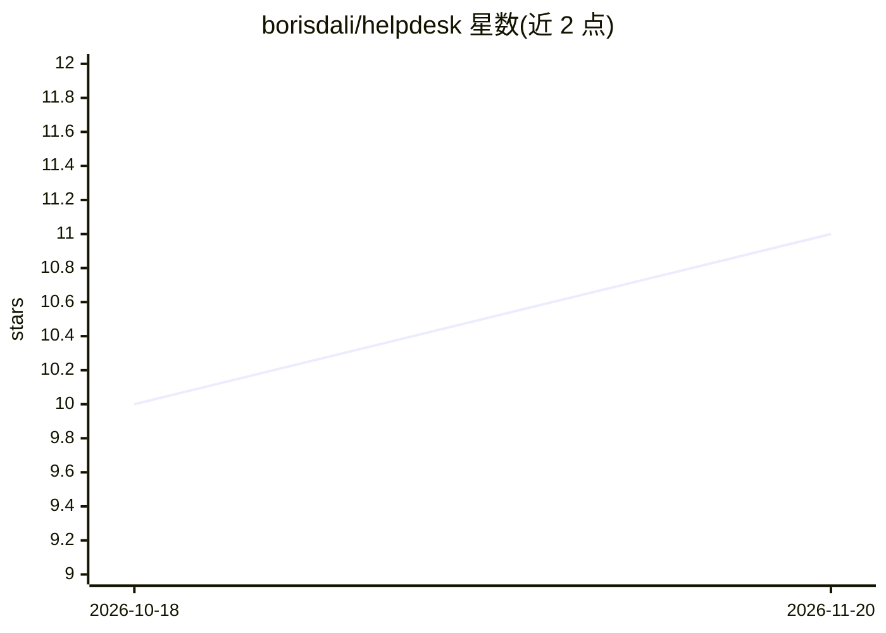

# borisdali/helpdesk

⭐ 11 · Go · 推送 2026-11-19 · [GitHub](https://github.com/borisdali/helpdesk) · [官网](https://aiHelpDesk.biz) · 个人维护

**数据库故障响应的治理型 AI Agent 系统，供 DBA/SRE 使用**

aiHelpDesk 是面向生产数据库故障响应与修复的问责层：诊断事故、提出修复方案，在治理框架下执行修复动作，每次工具调用有防篡改审计，破坏性操作需人工审批。机制包括故障→处置知识库（Vault）、playbook 稳定性认证（结果/结论/评估三维度）、32 种故障注入测试、多数据库舰队操作（金丝雀、审批门、漂移检测）。基于 Google ADK 与 A2A 协议构建多 Agent 架构。支持 VM/裸机、Docker/Podman、K8s/Helm 部署，提供 Linux x86-64/ARM 与 macOS 二进制。

## 筛选速览

| 维度 | 判定 | 备注 |
|---|---|---|
| AI 角色 | `ai-native` | 本体是模型或模型工具 |
| 许可风险 | `none` | — |
| 部署形态 | `self-host` | docker 或自建部署 |
| 模型依赖 | locked-api |  |
| 硬件要求 | — | 无带数字的原话,不猜 |
| 安装摩擦 | `low` | 无编译、无系统依赖或容器化 |
| 成熟度 | — | 结构信号不足 |

## 能力要点

- 治理执行臂：工具注册表、策略引擎、爆炸半径守卫、需人工审批的破坏性操作
- 故障注入测试：32 种已知故障模式，验证 agent 诊断与恢复
- 每次解决事故自动生成 playbook 草稿，形成 Vault 知识库
- playbook 上线前三维度稳定性认证（outcome/conclusion/evaluation）

## 适用场景

- 生产数据库出事故时让 AI 在治理框架下诊断并修复
- 用故障注入验证 AI 修复方案是否稳定可靠
- 跨多套数据库协调带审批门的变更操作

## 场景标签

`多智能体` `模型评测` · 领域:Agent 开发

## 证据(README 行号)

> L11: aiHelpDesk is the accountability layer for teams using AI agents on production databases hosted on VM/Bare Metal, i
> L13: A _productivity_ agent makes your team faster. An _accountability_ agent certifies that any actions taken were corr
> L44: - **Fault injection testing** — inject 32 known failure modes (SQL-only, SSH, K8s) against your own staging databas

## 星数曲线

2026-10-18 10 → 2026-11-20 11（+1）

---
*卡片 v1 · prompt 1.4 · 生成 2026-11-19 · 置信度 high · 依据 README sha `902765daa101` · [字段定义](../../DATASET.md)*
