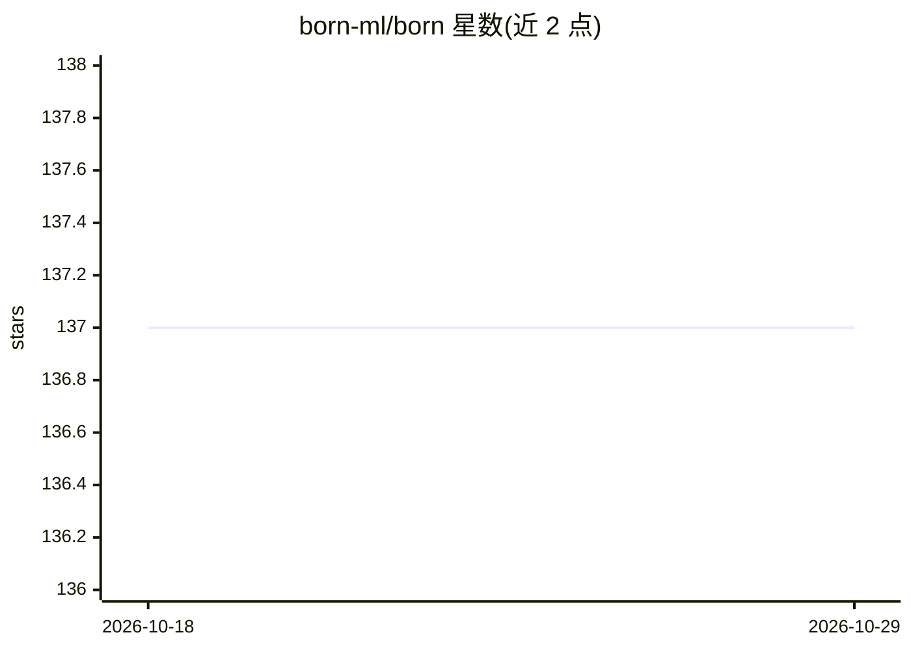

# born-ml/born

⭐ 137 · Go · Apache-2.0 · 推送 2026-09-25 · [GitHub](https://github.com/born-ml/born) · [官网](https://pkg.go.dev/github.com/born-ml/born) · 组织维护

**纯 Go 深度学习框架：单二进制训练与部署模型**

面向 Go 开发者的深度学习框架，受 Rust 的 Burn 启发。提供泛型类型安全的 Tensor API、自动微分、NN 模块、SGD/Adam 优化器；通过零 CGO 的 WebGPU 后端（gogpu/wgpu）提供 38+ GPU 算子，当前仅支持 Windows (D3D12)，Linux/macOS 为规划项。支持 LLM 推理（Flash Attention 2、投机解码、KV-Cache、GQA），可导入 ONNX（57 算子）、GGUF（含 K-quant 反量化，验证于 TinyLlama 1.1B）与 SafeTensors，导出原生 .born 格式。训练与部署编译为单二进制，无需 Python 运行时。安装方式为 git clone 源码构建，需 Go 1.26+。

## 筛选速览

| 维度 | 判定 | 备注 |
|---|---|---|
| AI 角色 | `ai-ecosystem` | LLM/agent 周边工具 |
| 许可风险 | `permissive` | Apache-2.0 |
| 部署形态 | `None` |  |
| 模型依赖 | — | README 未给出锁定关系 |
| 硬件要求 | — | 无带数字的原话,不猜 |
| 安装摩擦 | `medium` | 含编译或系统依赖之一 |
| 成熟度 | — | 结构信号不足 |

## 能力要点

- 纯 Go、零 CGO，模型编译为单二进制部署
- WebGPU 后端 38+ GPU 算子（MatMul 基准 123x 加速，Windows D3D12）
- LLM 推理原语：Flash Attention 2、投机解码、KV-Cache、GQA、RoPE
- 模型导入：ONNX 57 算子、GGUF K-quant、SafeTensors；原生 .born 格式

## 适用场景

- 在 Go 服务中训练和部署 ML 模型，避免 Python 运行时依赖
- 导入 PyTorch 训练的 ONNX/GGUF 模型以单二进制方式推理
- 在 Go 中运行 LLaMA 类模型的 GPU 推理（含流式生成）
- 编译到 WebAssembly 在浏览器中运行推理

## 场景标签

`模型训练` `推理引擎` · 领域:训练与推理

## 证据(README 行号)

> L18: Born is a modern deep learning framework for Go, inspired by Burn (Rust). Build ML models in pure Go and deploy as 
> L150: Born uses a backend interface for device independence:

## 星数曲线

2026-10-18 137 → 2026-10-29 137（+0）

---
*卡片 v1 · prompt 1.4 · 生成 2026-10-22 · 置信度 high · 依据 README sha `0dcfd0278ba8` · [字段定义](../../DATASET.md)*
