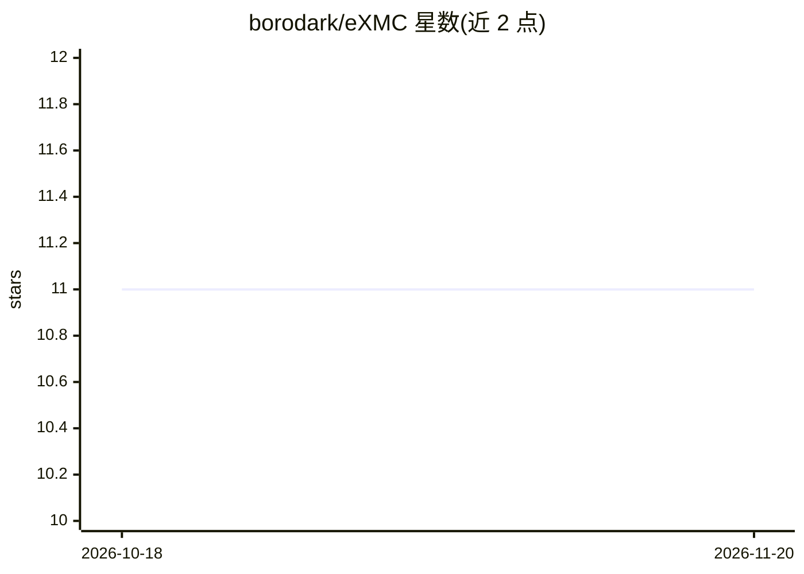

# borodark/eXMC

⭐ 11 · Elixir · NOASSERTION · 推送 2026-09-13 · [GitHub](https://github.com/borodark/eXMC) · [官网](http://www.dataalienist.com/) · 个人维护

**BEAM 上的概率编程环境：Elixir 实现贝叶斯推断**

受 PyMC 启发的 Elixir 概率编程库：声明式模型定义、自动约束变换、非中心化参数化重写，提供 NUTS（Stan 式三阶段预热）、ADVI、SMC 与 Pathfinder 四种推断方法，支持 16 种分布与 WAIC/LOO 模型比较。多链以轻量进程并行运行，样本以 BEAM 消息流式输出供 Scenic/LiveView 等可视化层消费。张量运算经 Nx，按 EXLA > Vulkan > CPU 顺序自动选后端；macOS 与 Windows 未被支持。

## 筛选速览

| 维度 | 判定 | 备注 |
|---|---|---|
| AI 角色 | `ai-native` | 本体是模型或模型工具 |
| 许可风险 | `none` | NOASSERTION |
| 部署形态 | `None` |  |
| 模型依赖 | — | README 未给出锁定关系 |
| 硬件要求 | — | 无带数字的原话,不猜 |
| 安装摩擦 | `medium` | 含编译或系统依赖之一 |
| 成熟度 | — | 结构信号不足 |

## 能力要点

- 四种推断方法：NUTS、ADVI、SMC、Pathfinder，含 ESS/R-hat/WAIC/LOO 诊断
- sample_stream/4 将逐样本以 BEAM 消息推送至任意进程（LiveView/GenServer/Scenic）
- 三后端 CPU/EXLA/Vulkan 自动选择，Vulkan 面向无 CUDA 的 f64 GPU
- :peer 节点分布式采样，节点失败自动在协调者重试

## 适用场景

- 在 Elixir/BEAM 项目中做贝叶斯参数估计与后验推断
- 多链并行采样时实时流式观察诊断统计量
- 在没有 CUDA 的机器（如 FreeBSD/iGPU）上运行 GPU 推断

## 场景标签

 · 领域:机器学习/统计计算

## 证据(README 行号)

> L5: **A PPL environment on the BEAM, inspired by PyMC.** eXMC is a from-scratch Elixir implementation of PyMC's architec
> L22: - Statistical correctness: NUTS with Stan-style three-phase warmup, ESS/R-hat, WAIC/LOO.
> L178: eXMC's tensor operations go through Nx.

## 星数曲线

2026-10-18 11 → 2026-11-20 11（+0）

---
*卡片 v1 · prompt 1.4 · 生成 2026-11-18 · 置信度 high · 依据 README sha `4d44b3327cef` · [字段定义](../../DATASET.md)*
