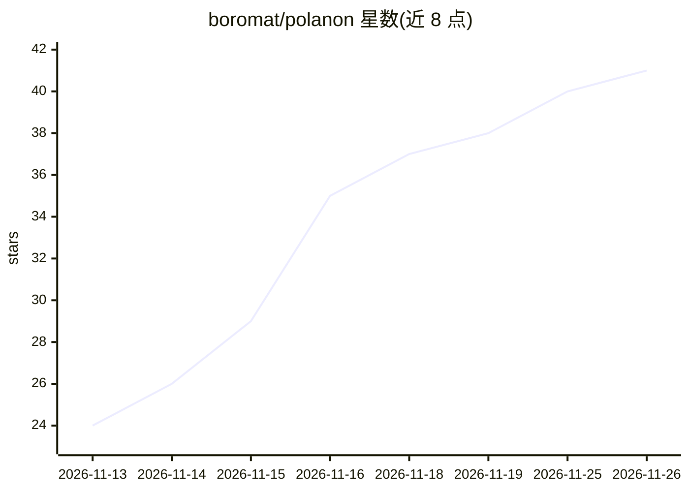

# boromat/polanon

⭐ 41 · Python · MIT · 推送 2026-11-24 · [GitHub](https://github.com/boromat/polanon) · [官网](https://boromat.pl/polanon/) · 个人维护

**面向波兰语场景的可逆 PII 掩码库：LLM 调用与 RAG 前后脱敏还原**

纯 Python 标准库实现的 PII 掩码库：在提示词离开网络前掩码个人数据，仅向模型发送稳定令牌（如 <OSOBA_1>），并在回答流式输出过程中还原原文。核心机制包括校验和验证的 PESEL/NIP/REGON/身份证号/IBAN/银行卡号、七种语法格式的波兰语姓名识别（无需语言模型，spaCy 模型可选扩展）。提供 Python API、CLI、可配合 Anthropic/OpenAI SDK 的示例、OpenAI/Anthropic API 网关（Docker 镜像）及 Haystack 3 组件；turn API 支持带工具调用的多轮对话掩码与还原。

## 筛选速览

| 维度 | 判定 | 备注 |
|---|---|---|
| AI 角色 | `ai-ecosystem` | LLM/agent 周边工具 |
| 许可风险 | `permissive` | MIT |
| 部署形态 | `desktop` | 安装包/桌面程序 |
| 模型依赖 | local-ok | 支持本地模型 |
| 硬件要求 | — | 无带数字的原话,不猜 |
| 安装摩擦 | `low` | 无编译、无系统依赖或容器化 |
| 成熟度 | — | 结构信号不足 |

## 能力要点

- 校验和验证的波兰标识符（PESEL 约 98% 拒绝随机数字串）
- 七种语法格式的波兰语姓名识别，核心无需语言模型
- 流式回答中的稳定令牌还原（StreamRestorer）
- Docker 网关使 OpenAI/Anthropic API 兼容工具无代码接入

## 适用场景

- LLM 调用前对波兰语个人数据脱敏、回答后自动还原
- 在 Claude Code、n8n、Open WebUI 等工具前部署掩码网关
- 带工具调用的多轮对话一次性掩码整个 turn 并按策略拒发无法掩码的内容

## 场景标签

`网络安全` · 领域:学习与行业

## 证据(README 行号)

> L9: **Reversible PII masking for LLM calls, Polish-first.** Mask personal data before a prompt leaves
> L18: **Without writing code**, with the gateway in Docker. Claude Code, n8n, Open WebUI, LibreChat,
> L158: ## With Claude, GPT or a local model

## 星数曲线

2026-11-13 24 → 2026-11-26 41（+17）

---
*卡片 v1 · prompt 1.4 · 生成 2026-11-18 · 置信度 high · 依据 README sha `40197498756d` · [字段定义](../../DATASET.md)*
