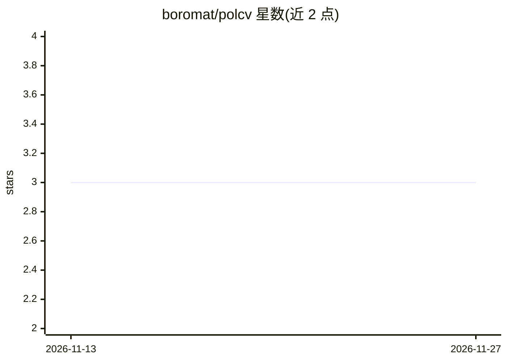

# boromat/polcv

⭐ 3 · TypeScript · MIT · 推送 2026-11-24 · [GitHub](https://github.com/boromat/polcv) · [官网](https://boromat.pl/#polcv) · 个人维护

**面向波兰求职者的本地简历定制生成器**

运行在本机的简历生成工具：粘贴招聘链接后，AI 提取要求与关键词，追问资料缺口，生成针对该职位与 ATS 的简历（PDF），并给出 ATS 与 AI 招聘官双维度评分与自动修正；另支持模拟面试、求职意向访谈、职位推荐。数据保留在本地 data 文件夹，仅向 OpenRouter 发送简历与招聘文本，可选 polanon 做 PII 标记。限制：界面提供波兰语/英语，简历生成默认依赖 OpenRouter API key，按用量付费。

## 筛选速览

| 维度 | 判定 | 备注 |
|---|---|---|
| AI 角色 | `ai-native` | 本体是模型或模型工具 |
| 许可风险 | `permissive` | MIT |
| 部署形态 | `desktop` | 安装包/桌面程序 |
| 模型依赖 | locked-api |  |
| 硬件要求 | — | 无带数字的原话,不猜 |
| 安装摩擦 | `low` | 无编译、无系统依赖或容器化 |
| 成熟度 | — | 结构信号不足 |

## 能力要点

- 针对特定职位的 ATS 优化简历生成，支持波兰语关键字变体处理
- 自动添加符合波兰劳动法的 RODO（GDPR）条款与照片处理
- 基于招聘链接的 AI 招聘官评分（0-100）与自动修正
- 可选 polanon PII 标记（含 spaCy NER 支持）

## 适用场景

- 将简历投递到本地/国际职位前进行 ATS 优化
- 投递前准备模拟面试
- 保护求职材料中的个人隐私信息

## 场景标签

`AI 写作` `AI 助手` · 领域:对话与助手

## 证据(README 行号)

> L8: **CV pod konkretne ogłoszenie - zrobione dla polskiego rynku pracy.** Otwarty program na Twój komputer dla studentów
> L16: - **polskie portale** - czyta ogłoszenia z pracuj.pl, justjoin.it, nofluffjobs i Smart Jobs,
> L33: Wszystkie dane zostają na Twoim komputerze, w folderze `data`. Do AI (przez OpenRouter) wysyłana jest tylko treść p

## 星数曲线

2026-11-13 3 → 2026-11-27 3（+0）

---
*卡片 v1 · prompt 1.4 · 生成 2026-11-22 · 置信度 mid · 依据 README sha `c1a5cec0b80a` · [字段定义](../../DATASET.md)*
