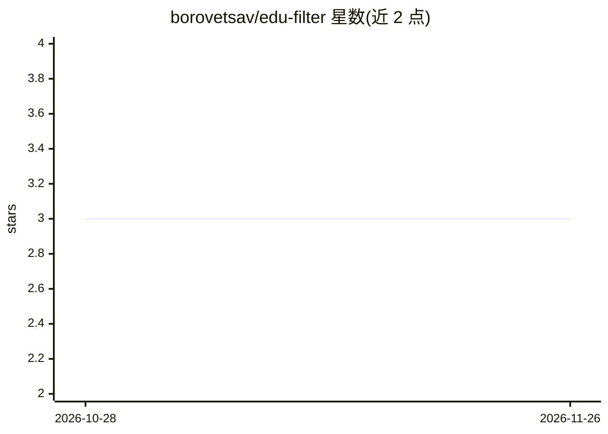

# borovetsav/edu-filter

⭐ 3 · JavaScript · MIT · 推送 2026-10-26 · [GitHub](https://github.com/borovetsav/edu-filter) · 个人维护

**给 YouTube 长课程自动插入小结与测验的 Chrome 扩展**

Chrome 扩展（Manifest V3），监控 YouTube 课程播放进度，每约 40 分钟弹出一张卡片；点击后自动驱动 Gemini 网页版（非 API），生成带时间戳的小结与可点击的理解型测验。支持设置测验间隔（自动对齐章节起点）、题数、答案语言，可在后台标签页自动判断视频是否为教育内容。无需 API key、无服务器、免费，但依赖已登录的 Gemini 会话，页面改版可能使选择器失效。

## 筛选速览

| 维度 | 判定 | 备注 |
|---|---|---|
| AI 角色 | `ai-native` | 本体是模型或模型工具 |
| 许可风险 | `permissive` | MIT |
| 部署形态 | `desktop` | 安装包/桌面程序 |
| 模型依赖 | — | README 未给出锁定关系 |
| 硬件要求 | — | 无带数字的原话,不猜 |
| 安装摩擦 | `low` | 无编译、无系统依赖或容器化 |
| 成熟度 | — | 结构信号不足 |

## 能力要点

- 每约 40 分钟自动插入小结与测验卡片，并对齐章节起点
- 驱动 Gemini 网页界面而非 API，无需 API key、无服务器
- 可配置题数（1-20）、答案语言与测验间隔
- 后台标签页自动分类视频为教育/娱乐内容

## 适用场景

- 看长 YouTube 课程时定期自测以巩固记忆
- 快速获取课程的时间戳小结
- 为教育类视频自动生成理解型练习题

## 场景标签

 · 领域:教育/浏览器扩展

## 证据(README 行号)

> L3: **Remember the lectures you watch.** A Chrome extension that adds quiz breaks to long YouTube lectures: every ~40 mi
> L28: 3. **Click "Summary and quiz":** Gemini opens with a summary by timestamps and a clickable quiz that tests understa
> L69: The extension drives Gemini's web interface rather than an API. Things that came up:

## 星数曲线

2026-10-28 3 → 2026-11-26 3（+0）

---
*卡片 v1 · prompt 1.4 · 生成 2026-11-22 · 置信度 high · 依据 README sha `e240b0bae9dd` · [字段定义](../../DATASET.md)*
