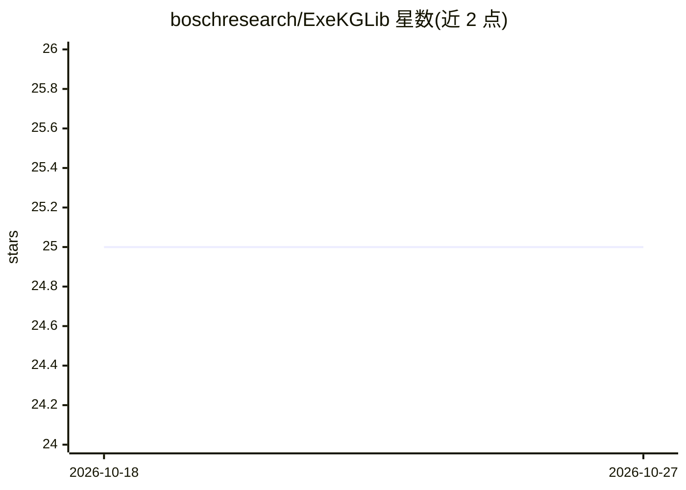

# boschresearch/ExeKGLib

⭐ 25 · Python · AGPL-3.0 · 推送 2026-03-19 · [GitHub](https://github.com/boschresearch/ExeKGLib) · 组织维护

**用知识图谱构建与执行机器学习流水线的 Python 库**

由 Bosch Research 维护的 Python 库，将机器学习与数据分析流水线表示为可执行知识图谱（ExeKG）：用户通过 JSON 文件、编码接口或 CLI 定义流水线，库将其转换为 RDF Turtle 格式的 ExeKG，校验可执行性后再自动转换为 Python 代码并运行。底层使用 pandas、matplotlib、scikit-learn 处理数据与预测，内置 ML、统计、可视化三类任务 schema，支持新增任务与方法。以 pip 包形式发布。

## 筛选速览

| 维度 | 判定 | 备注 |
|---|---|---|
| AI 角色 | `ai-ecosystem` | LLM/agent 周边工具 |
| 许可风险 | `viral` | AGPL-3.0 |
| 部署形态 | `library` | 以包/库形式分发 |
| 模型依赖 | — | README 未给出锁定关系 |
| 硬件要求 | — | 无带数字的原话,不猜 |
| 安装摩擦 | `low` | 无编译、无系统依赖或容器化 |
| 成熟度 | — | 结构信号不足 |

## 能力要点

- JSON 文件即可无代码定义 ML 流水线并自动转换为 ExeKG
- 流水线保存为 RDF Turtle 格式，可查询与分析
- ExeKG 自动校验、转换为 Python 代码并执行
- 支持批量创建/编辑流水线，可扩展新任务与方法

## 适用场景

- 用 JSON 无代码构建并执行分类训练与评估流水线
- 以知识图谱形式保存、查询和复用数据分析流水线
- 批量生成与编辑多条 ML/统计/可视化流水线

## 场景标签

`知识图谱` · 领域:知识与检索

## 证据(README 行号)

> L9: ExeKGLib is a Python library that simplifies the construction and execution of Machine Learning (ML) pipelines repre
> L27: Under the hood, **ExeKGLib** uses well-known Python libraries for data processing and visualization and performing 

## 星数曲线

2026-10-18 25 → 2026-10-27 25（+0）

---
*卡片 v1 · prompt 1.4 · 生成 2026-10-27 · 置信度 high · 依据 README sha `f793f343857f` · [字段定义](../../DATASET.md)*
