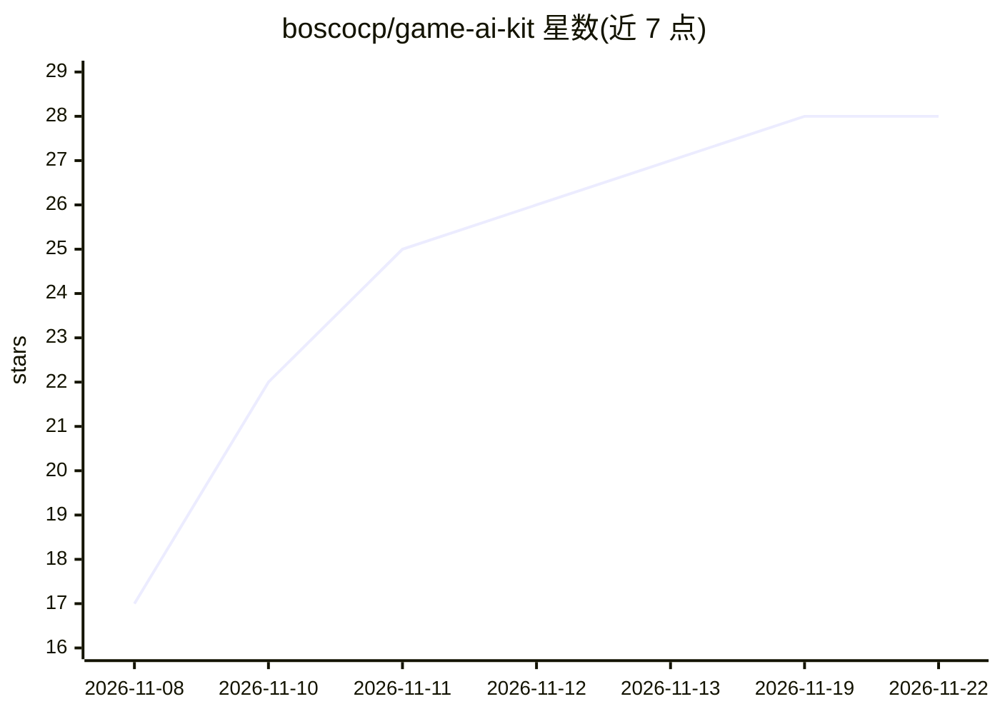

# boscocp/game-ai-kit

⭐ 28 · GDScript · Apache-2.0 · 推送 2026-11-12 · [GitHub](https://github.com/boscocp/game-ai-kit) · 个人维护

**游戏 AI 教学套件：Godot 4 插件与可读小游戏演示决策算法**

面向学习者的 Godot 4 插件集合加配套小游戏：每个示例游戏由特定 AI 技术做出真实决策，覆盖 minimax/MCTS、行为树/GOAP/HTN、贝叶斯网络、约束求解、模糊逻辑、寻路、行为克隆、UCB1 等，附 Python 训练半部（PyPI 包 gameaikit）。含 ai_llm 模块：语言模型经校验器后才成为动作，可用录制回放或本地 llama.cpp 服务器（OpenAI 兼容）运行。代码以可读性优先，机器学习只用于具体小片段而非整局游戏。运行分四档，最低档零依赖仅读文档。

## 筛选速览

| 维度 | 判定 | 备注 |
|---|---|---|
| AI 角色 | `ai-native` | 本体是模型或模型工具 |
| 许可风险 | `permissive` | Apache-2.0 |
| 部署形态 | `library` | 以包/库形式分发 |
| 模型依赖 | — | README 未给出锁定关系 |
| 硬件要求 | — | 无带数字的原话,不猜 |
| 安装摩擦 | `low` | 无编译、无系统依赖或容器化 |
| 成熟度 | — | 结构信号不足 |

## 能力要点

- 20+ 种游戏 AI 技术各有独立插件与至少一个演示游戏
- ai_llm：语言模型输出经校验器验证后才成为动作，支持录制回放与本地 llama.cpp 服务器
- 机器学习仅用于可打印权重的具体片段（如逻辑回归决定攻击/撤退）
- 四档运行环境，集成显卡即可运行 2D 游戏，LLM 为可选最高档

## 适用场景

- 通过可运行的小游戏学习行为树、GOAP、MCTS 等游戏 AI 技术
- 将单个 Godot 插件连同 ai_core 拿到自己的游戏项目中使用
- 用本地 LLM 体验经校验器约束的对话式 AI 玩法

## 场景标签

`教程课程` · 领域:学习与行业

## 证据(README 行号)

> L14: A set of Godot 4 addons you can take **one at a time**, plus small games,
> L40: |ai_llm|a language model behind a validator|a language model reading discourse acts, behind a validator|● `make dem

## 星数曲线

2026-11-08 17 → 2026-11-22 28（+11）

---
*卡片 v1 · prompt 1.4 · 生成 2026-11-18 · 置信度 high · 依据 README sha `3f8d8561a50d` · [字段定义](../../DATASET.md)*
