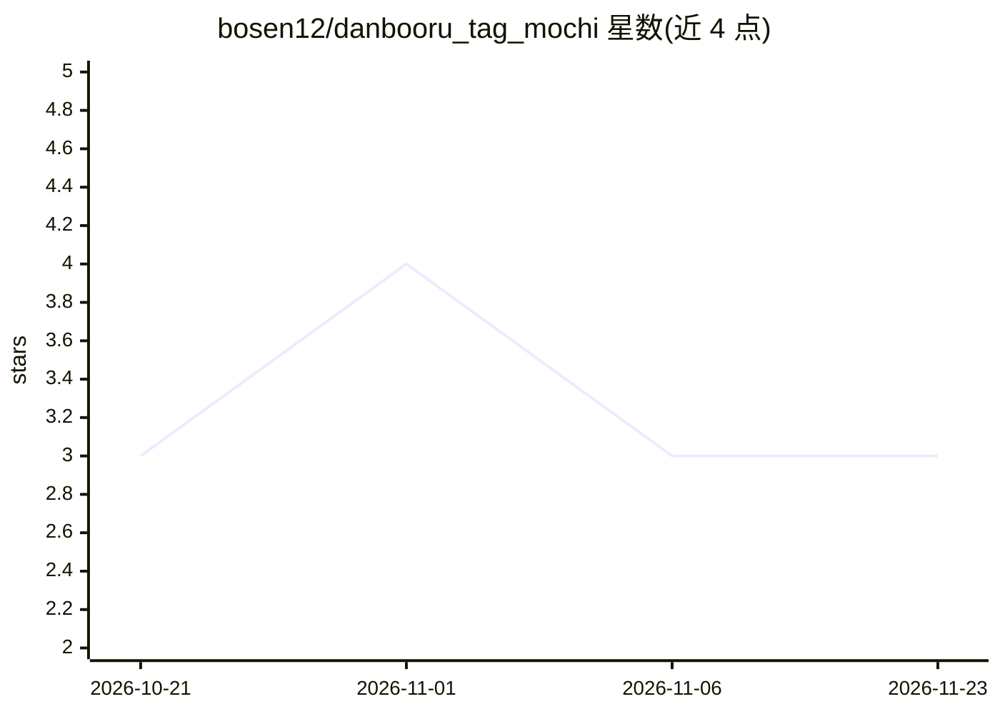

# bosen12/danbooru_tag_mochi

⭐ 3 · JavaScript · GPL-3.0 · 推送 2026-11-22 · [GitHub](https://github.com/bosen12/danbooru_tag_mochi) · 个人维护 · 中文 README

**将 Danbooru 标签以卡片形式组合生成图像，并连接到本地 ComfyUI 的工具。**

Mochi 是一个面向本地 ComfyUI（WAI/Illustrious SDXL）的卡片式工作台，用于图像生成。用户将 Danbooru 标签钉选为插图卡片，引擎依据规则补全剩余标签并送入 ComfyUI 生成图像。支持多种模型家族，每个家族有独立的提示词格式、工作流、步数、CFG、采样器与调度器。界面分五个房间（Ink Pool、Fuse Bed、Card Book、Gallery、Parse Pool），提供英文与繁中界面。负面提示词可按家族/检查点/自定义工作流编辑，内置分级词与防护屏蔽。服务器仅接受回环与 Tailscale 连接。

## 筛选速览

| 维度 | 判定 | 备注 |
|---|---|---|
| AI 角色 | `ai-native` | 本体是模型或模型工具 |
| 许可风险 | `dual` | GPL-3.0 |
| 部署形态 | `desktop` | 安装包/桌面程序 |
| 模型依赖 | — | README 未给出锁定关系 |
| 硬件要求 | — | 无带数字的原话,不猜 |
| 安装摩擦 | `low` | 无编译、无系统依赖或容器化 |
| 成熟度 | — | 结构信号不足 |

## 能力要点

- 支持 SDXL（WAI/Illustrious）、Pony、Anima、Krea 2、Z-Image Turbo、MOSS-Image 多个模型家族
- Parse Pool 通过 ComfyUI 的 WD14 Tagger 从图片反向提取标签生成卡片
- 支持自定义卡片、卡组、收藏与分享码（mochi-card:）
- 内置未成年人相关标签屏蔽与服务端拒绝机制

## 适用场景

- 以钉选卡片方式组合 Danbooru 标签生成动漫图像
- 通过 WD14 Tagger 从已有图片提取标签复用
- 管理 LoRA 选择与按检查点匹配的负面提示词

## 场景标签

`图像生成` · 领域:内容生成

## 证据(README 行号)

> L10: Danbooru tags as illustrated cards. Pin a few cards, let the engine draw the rest by its rules, and send the compos
> L57: ## Requirements
> L66: ## Getting started

## 星数曲线

2026-10-21 3 → 2026-11-23 3（+0）

---
*卡片 v1 · prompt 1.4 · 生成 2026-11-22 · 置信度 mid · 依据 README sha `5885878c1ded` · [字段定义](../../DATASET.md)*
