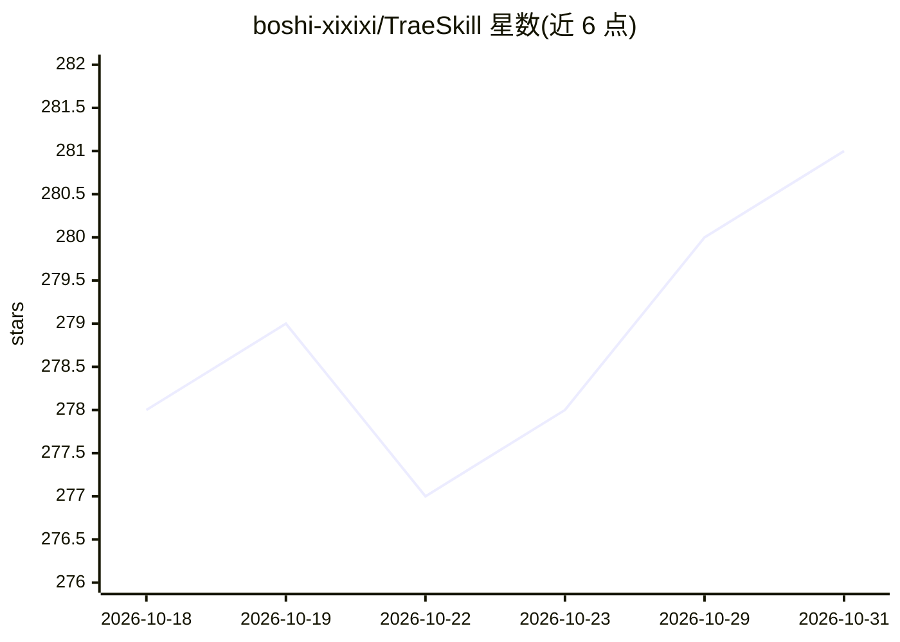

# boshi-xixixi/TraeSkill

⭐ 281 · Python · MIT · 推送 2026-05-12 · [GitHub](https://github.com/boshi-xixixi/TraeSkill) · 个人维护 · 中文 README

**为 Trae IDE（兼 Cursor）提供的标准化 AI 编码技能集合**

面向 Trae IDE `.trae/skills` 机制设计的 AI 技能库，按软件开发生命周期组织约 30 个 Skill：需求拆解与调度分发、PRD 生成、API 设计、前后端开发、测试、Git 工作流、SEO、办公自动化、安全审计与 RAG/LangChain 架构等，另有三个图表生成 Skill（SVG/PNG、深色架构图、Excalidraw 手绘图）。通过 git clone 放入项目或用户目录即可被 Trae 自动索引；附带 cursor_adapter/ 适配脚本，自动生成 Cursor 兼容的 .cursor/skills/ 目录。

## 筛选速览

| 维度 | 判定 | 备注 |
|---|---|---|
| AI 角色 | `ai-knowledge` | 知识聚合/清单类 |
| 许可风险 | `permissive` | MIT |
| 部署形态 | `None` |  |
| 模型依赖 | — | README 未给出锁定关系 |
| 硬件要求 | — | 无带数字的原话,不猜 |
| 安装摩擦 | `low` | 无编译、无系统依赖或容器化 |
| 成熟度 | — | 结构信号不足 |

## 能力要点

- 按生命周期分组的 30 余个研发角色 Skill（产品/架构/开发/测试/SEO 等）
- Meta_Dispatcher 任务调度与需求拆解
- 三个图表生成 Skill（SVG+PNG / 深色架构图 / Excalidraw）
- cursor_adapter/ 适配层以非侵入方式支持 Cursor IDE

## 适用场景

- 在 Trae 中让 AI 按专业角色（架构师、测试专家等）参与开发
- 把团队研发规范沉淀为可复用 Skill 分发
- Cursor 用户经适配脚本复用同一套技能

## 场景标签

`提示工程` · 领域:Agent 开发

## 证据(README 行号)

> L23: TraeSkill 是一个标准化的 **AI 技能集合**，为 Trae IDE 的 `.trae/skills` 机制设计。
> L25: **它的目标是**：把「行业最佳实践」沉淀为可复用的 Skill，让 AI 在 Trae 中扮演专业角色——产品经理、架构师、前端工程师、后端开发者、测试专家、SEO 专家等。

## 星数曲线

2026-10-18 278 → 2026-10-31 281（+3）

---
*卡片 v1 · prompt 1.4 · 生成 2026-10-22 · 置信度 high · 依据 README sha `ae88fac8cb19` · [字段定义](../../DATASET.md)*
