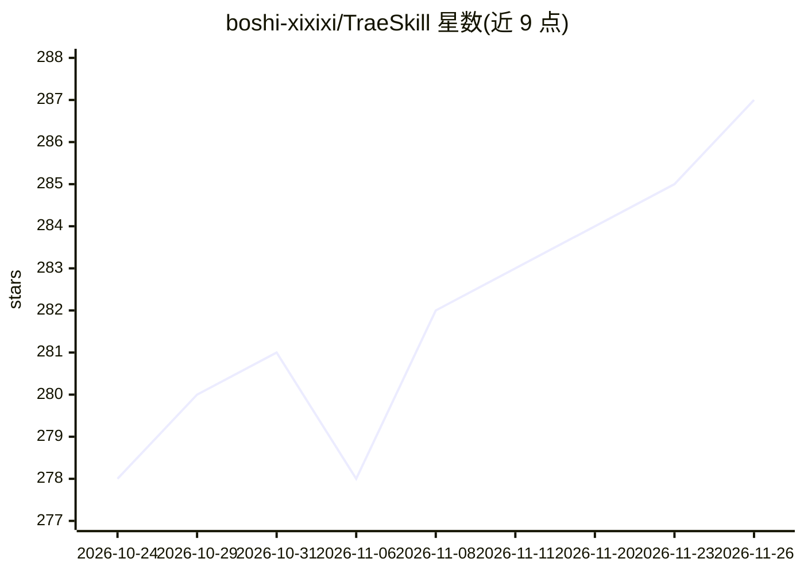

# boshi-xixixi/TraeSkill

⭐ 287 · Python · MIT · 推送 2026-11-21 · [GitHub](https://github.com/boshi-xixixi/TraeSkill) · 个人维护 · 中文 README

**为 Trae IDE 提供全流程标准化 AI 编码技能库**

TraeSkill 是面向 Trae IDE `.trae/Skills` 机制的标准化技能集合，按软件生命周期分组收录数十个 Skill：产品与设计、前后端开发、测试与运维、SEO 增长、办公自动化、安全与 AI 工程等，并以 Meta_Dispatcher 等元技能负责任务调度与需求拆解。安装方式为 git clone 后复制到项目或用户级技能目录，由 Trae 自动索引；另提供 cursor_adapter 脚本生成 Cursor 兼容目录。项目维护更新日志与版本同步说明，采用 MIT 许可。

## 筛选速览

| 维度 | 判定 | 备注 |
|---|---|---|
| AI 角色 | `ai-knowledge` | 知识聚合/清单类 |
| 许可风险 | `permissive` | MIT |
| 部署形态 | `None` |  |
| 模型依赖 | — | README 未给出锁定关系 |
| 硬件要求 | — | 无带数字的原话,不猜 |
| 安装摩擦 | `low` | 无编译、无系统依赖或容器化 |
| 成熟度 | — | 结构信号不足 |

## 能力要点

- 按生命周期分组的 Skill 目录：产研、开发、测试运维、SEO、办公自动化、AI 工程
- Meta_Dispatcher/Meta_SkillCreator 等元技能支持任务调度与技能创建
- 提供 cursor_adapter 适配脚本，自动生成 Cursor 兼容的 .cursor/skills 目录
- 三个图表生成 Skill（SVG/PNG、HTML/PDF、Excalidraw 格式）

## 适用场景

- 在 Trae IDE 中让 AI 按规范流程完成需求梳理、API 设计到部署
- 用 Playwright 等技能补齐项目的测试与安全审计环节
- 在 Cursor IDE 中通过适配层复用同一套技能
- 为技术文档生成架构图、UML 图等图表

## 场景标签

`编码 Agent` `提示工程` · 领域:Agent 开发

## 证据(README 行号)

> L24: TraeSkill 是一个标准化的 **AI 技能集合**，为 Trae IDE 的 `.trae/Skills` 机制设计。
> L26: **它的目标是**：把「行业最佳实践」沉淀为可复用的 Skill，让 AI 在 Trae 中扮演专业角色——产品经理、架构师、前端工程师、后端开发者、测试专家、SEO 专家等。
> L68: 在 Trae 中打开此仓库，AI 会自动索引到项目内 `.trae/Skills` 下的所有技能。

## 星数曲线

2026-10-24 278 → 2026-11-26 287（+9）

---
*卡片 v1 · prompt 1.4 · 生成 2026-11-25 · 置信度 mid · 依据 README sha `8fa479dd7440` · [字段定义](../../DATASET.md)*
