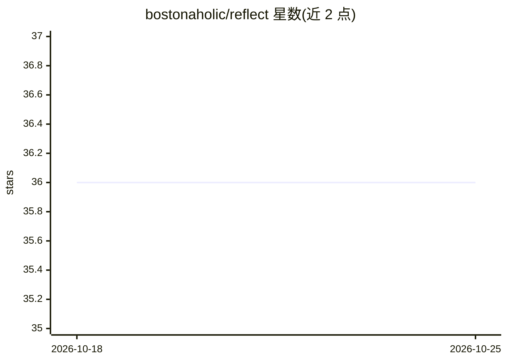

# bostonaholic/reflect

⭐ 36 · TypeScript · MIT · 推送 2026-10-22 · [GitHub](https://github.com/bostonaholic/reflect) · [官网](https://bostonaholic.github.io/reflect/) · 个人维护

**根据 GitHub 贡献记录生成 brag 文档的 AI 命令行工具**

面向希望整理工作成果的开发者：通过 GitHub 官方 Octokit 客户端拉取指定用户在时间范围内合并的 PR 与关闭的 issue，按关闭日期排序生成贡献清单 Markdown；可选调用 LLM 生成技术摘要、面向绩效评审的 brag 文档或幽默 roast 文档。支持 OpenAI 与 Anthropic 提供商及自定义 base URL，可按组织与仓库过滤。需 GitHub PAT（repo、read:org 权限）与 Node.js v22+，附 Claude Code 插件。

## 筛选速览

| 维度 | 判定 | 备注 |
|---|---|---|
| AI 角色 | `ai-native` | 本体是模型或模型工具 |
| 许可风险 | `permissive` | MIT |
| 部署形态 | `library` | 以包/库形式分发 |
| 模型依赖 | locked-api |  |
| 硬件要求 | — | 无带数字的原话,不猜 |
| 安装摩擦 | `low` | 无编译、无系统依赖或容器化 |
| 成熟度 | — | 结构信号不足 |

## 能力要点

- 拉取指定时间范围的合并 PR 与关闭 issue 并生成 Markdown 贡献清单
- LLM 生成技术摘要、brag 文档与 roast 文档（OpenAI/Anthropic 可选）
- 按组织与仓库进行包含/排除过滤
- 附带 Claude Code 插件提供安装与排障技能

## 适用场景

- 绩效评审前整理我在 GitHub 上的工作成果
- 生成可用于作品集的自我总结文档
- 按组织或仓库筛选特定范围的贡献记录

## 场景标签

`AI 写作` · 领域:内容生成

## 证据(README 行号)

> L3: Reflect: An AI tool to generate your brag document
> L60: - 🤖 Optional AI-powered summary and brag document generation
> L100: - `--brag`: Optional flag to generate a summary and brag document

## 星数曲线

2026-10-18 36 → 2026-10-25 36（+0）

---
*卡片 v1 · prompt 1.4 · 生成 2026-10-25 · 置信度 mid · 依据 README sha `d93b5e8e5f75` · [字段定义](../../DATASET.md)*
