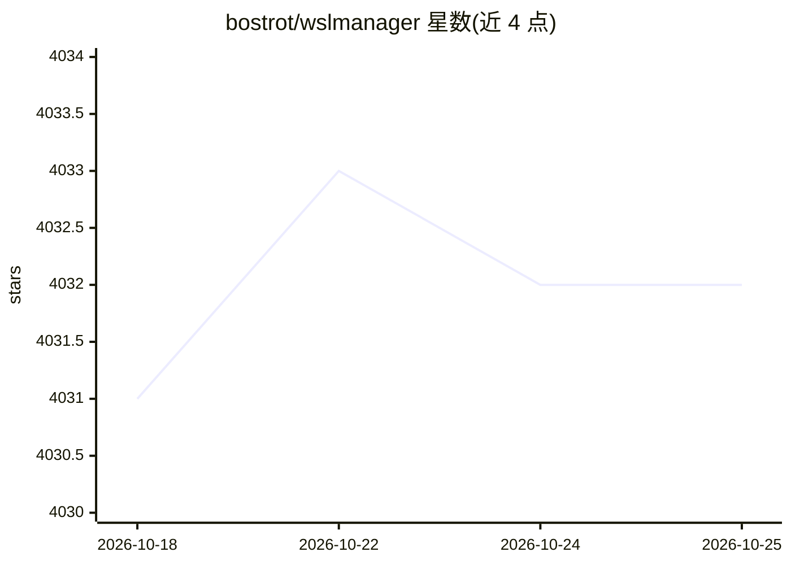

# bostrot/wslmanager

⭐ 4,033 · Dart · NOASSERTION · 推送 2026-10-01 · [GitHub](https://github.com/bostrot/wslmanager) · [官网](https://wslmanager.com) · 个人维护 · 中文 README

**WSL 与 macOS 虚拟机的图形化管理器，AI 层为付费功能**

Flutter 编写的开源 GUI：在 Windows 上安装、复制、迁移、备份 WSL 发行版，编辑 .wslconfig、挂载磁盘、SSH 管理远程 WSL；在 macOS 上通过 Apple Virtualization 框架管理 Linux/macOS 虚拟机（beta）。免费层覆盖全部管理功能；AI 能力为 Pro 付费层：带工具的 AI 助手（操作 WSL）、MCP 服务器、沙箱 distro、任务队列与 Web 仪表盘，模型凭证由用户自带（任意 OpenAI 兼容端点），可整体关闭。

## 筛选速览

| 维度 | 判定 | 备注 |
|---|---|---|
| AI 角色 | `ai-enhanced` | 去掉 AI 部分产品仍成立 |
| 许可风险 | `none` | NOASSERTION |
| 部署形态 | `desktop` | 安装包/桌面程序 |
| 模型依赖 | local-ok | 支持本地模型 |
| 硬件要求 | — | 无带数字的原话,不猜 |
| 安装摩擦 | `low` | 无编译、无系统依赖或容器化 |
| 成熟度 | — | 结构信号不足 |

## 能力要点

- 发行版全生命周期 GUI 管理：安装/复制/备份/迁移/压缩磁盘/.wslconfig 编辑
- macOS 上经 Apple Virtualization 框架管理 Linux 与 macOS 客户机 VM（beta）
- Pro 层：AI 助手带工具集直接操作 WSL，并通过 MCP 服务器暴露给 Claude Desktop 等客户端
- 任意 OpenAI 兼容端点自带密钥（OpenAI/Azure/LiteLLM/Ollama/LM Studio），AI 功能可整体关闭

## 适用场景

- 不想记 wsl.exe 命令行参数，用图形界面管理 WSL 发行版
- 在 Mac 上创建和管理 Linux/macOS 虚拟机
- 让 AI 助手或 MCP 客户端代为执行 WSL 管理操作
- 用一次性沙箱 distro 安全地运行 AI 对话

## 场景标签

 · 领域:系统/虚拟化管理工具

## 证据(README 行号)

> L26: > **WSL Distro Manager** is a free, open source GUI for the Windows Subsystem
> L117: **Don't want any of it?** **Settings → Bring Your Own AI Key → AI features** switches the assistant, the error dia

## 星数曲线

2026-10-18 4,031 → 2026-10-25 4,032（+1）

---
*卡片 v1 · prompt 1.4 · 生成 2026-10-20 · 置信度 mid · 依据 README sha `7fdcab16e6cf` · [字段定义](../../DATASET.md)*
