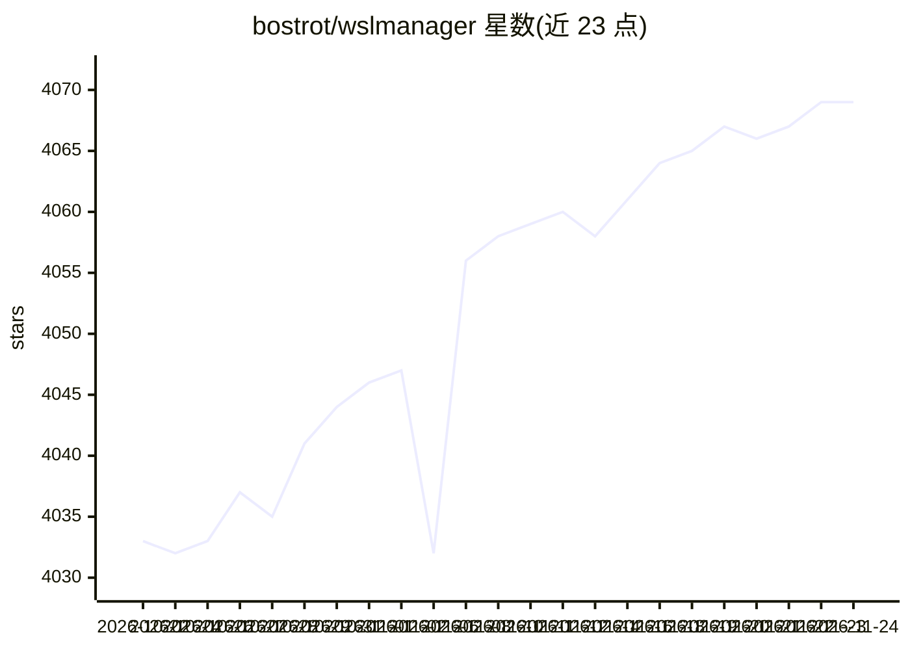

# bostrot/wslmanager

⭐ 4,071 · Dart · NOASSERTION · 推送 2026-11-23 · [GitHub](https://github.com/bostrot/wslmanager) · [官网](https://wslmanager.com) · 个人维护

**WSL 发行版的图形化管理器：免命令行安装/备份/迁移**

开源的 Windows Subsystem for Linux 图形管理器，另在 macOS 上通过 Apple Virtualization.framework 管理原生 Linux/macOS 虚拟机。功能覆盖从内置目录或自定义 rootfs 安装发行版、复制/改名/迁移/备份/恢复、虚拟磁盘压缩与挂载、.wslconfig 与 systemd 图形化配置、SSH 远程管理、片段命令等。Pro 付费层提供带工具调用的 AI 助手、沙箱化 AI、任务队列、MCP 服务器与 Web 控制台，AI 凭用户自备的 OpenAI 兼容 API key 运行，本产品不托管任何 AI 服务。

## 筛选速览

| 维度 | 判定 | 备注 |
|---|---|---|
| AI 角色 | `ai-enhanced` | 去掉 AI 部分产品仍成立 |
| 许可风险 | `none` | NOASSERTION |
| 部署形态 | `desktop` | 安装包/桌面程序 |
| 模型依赖 | local-ok | 支持本地模型 |
| 硬件要求 | — | 无带数字的原话,不猜 |
| 安装摩擦 | `low` | 无编译、无系统依赖或容器化 |
| 成熟度 | `idea` | |

## 能力要点

- 图形化完成 WSL 发行版的安装、复制、迁移、备份与恢复
- MCP 服务器以 HTTP 端点向 Claude Desktop、Claude Code、opencode 等 MCP 客户端暴露 WSL 工具
- macOS 版通过 Apple Virtualization.framework 管理 Linux 与 macOS 虚拟机
- AI 功能支持任意 OpenAI 兼容端点（OpenAI、Azure、LiteLLM、Ollama、LM Studio 等）

## 适用场景

- 在不记 wsl.exe 参数的情况下安装、备份和迁移 WSL 发行版
- 把配置好的发行版打包成 .wsl 模板分发到其他机器
- 通过 MCP 让 AI 客户端创建和管理 WSL 实例
- 在 Mac 上以图形界面创建和运维 Linux/macOS 虚拟机

## 场景标签

 · 领域:开发者工具/虚拟化管理

## 证据(README 行号)

> L26: > **WSL Distro Manager** is a free, open source GUI for the Windows Subsystem
> L82: - [x] **AI assistant with tools** — the built-in chat can actually *operate* your WSL: it lists and inspects distro
> L102: ## 🤖 AI assistant & MCP *(Pro)*

## 星数曲线

2026-10-22 4,033 → 2026-11-24 4,069（+36）

---
*卡片 v1 · prompt 1.4 · 生成 2026-11-23 · 置信度 mid · 依据 README sha `1c33486cc485` · [字段定义](../../DATASET.md)*
