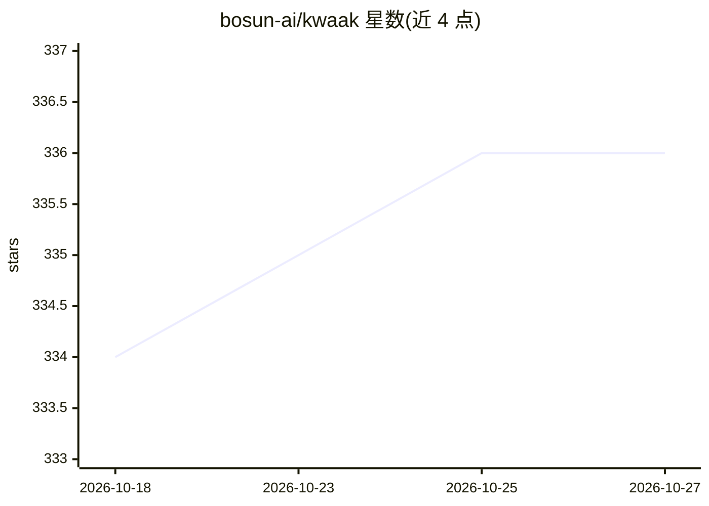

# bosun-ai/kwaak

⭐ 336 · Rust · MIT · 推送 2026-01-27 · [GitHub](https://github.com/bosun-ai/kwaak) · [官网](https://bosun.ai) · 组织维护

**终端中并行运行多 AI 编码 agent 的 Rust 工具（已停止维护）**

用 Rust 编写的终端应用：在本地并行运行多个自主 AI agent，操作代码库——索引代码（存储于 duckdb）、写并执行代码、lint、提交推送、创建 pull request。代码执行在按需创建的 Docker 容器中沙箱进行。支持 OpenAI、Ollama、Anthropic、Azure、OpenRouter 等提供商，可按任务（索引/查询/嵌入）混配模型，并可经 MCP 扩展工具。README 明确声明该项目已不再积极维护（L1-L2），且自述为 alpha 软件。安装提供预编译二进制、Homebrew、cargo 等方式。

## 筛选速览

| 维度 | 判定 | 备注 |
|---|---|---|
| AI 角色 | `ai-ecosystem` | LLM/agent 周边工具 |
| 许可风险 | `permissive` | MIT |
| 部署形态 | `desktop` | 安装包/桌面程序 |
| 模型依赖 | local-ok | 支持本地模型 |
| 硬件要求 | — | 无带数字的原话,不猜 |
| 安装摩擦 | `low` | 无编译、无系统依赖或容器化 |
| 成熟度 | `idea` | |

## 能力要点

- 并行运行多个自主 agent，终端聊天式交互
- 代码在按需创建的 Docker 容器中沙箱执行
- 索引/查询/嵌入可按任务混配不同提供商模型
- 支持 MCP 协议扩展自定义工具

## 适用场景

- 把技术债积压任务交给自主 agent 处理，生成 pull request
- 提升测试覆盖率、更新文档等重复性代码工作
- 让 agent 在隔离容器中执行并验证代码改动

## 场景标签

`编码 Agent` `多智能体` · 领域:Agent 开发

## 证据(README 行号)

> L33: Always wanted to run a team of AI agents locally from your own machine? Write code, improve test coverage, update d
> L35: Kwaak is free and open-source. You can bring your own API keys, or your own models via Ollama.
> L57: - Sandboxed execution in docker

## 星数曲线

2026-10-18 334 → 2026-10-27 336（+2）

---
*卡片 v1 · prompt 1.4 · 生成 2026-10-21 · 置信度 mid · 依据 README sha `76ceda984a39` · [字段定义](../../DATASET.md)*
