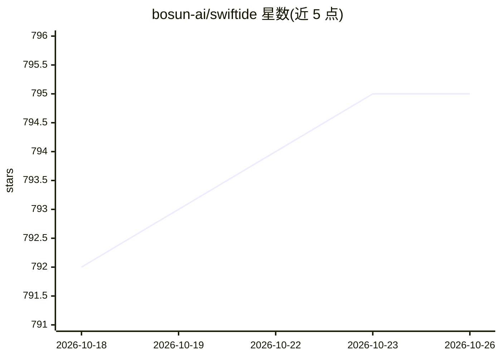

# bosun-ai/swiftide

⭐ 795 · Rust · MIT · 推送 2026-10-23 · [GitHub](https://github.com/bosun-ai/swiftide) · [官网](https://swiftide.rs) · 组织维护

**Rust 框架：为开发者构建 LLM agent、任务图与流式 RAG 管道**

面向 Rust 开发者的 LLM 应用构建框架，提供三大核心原语：agent harness（管理消息历史、LLM 调用、工具循环、生命周期钩子与停止条件）、强类型任务图 TaskNode 编排（含 fan-out/join、暂停恢复）、以及流式可组合的索引与查询 RAG 管道。集成为 feature-gated 可选，LLM 提供商覆盖 OpenAI/Azure、Anthropic、Gemini、Ollama、Bedrock 等，存储支持 Qdrant、PgVector、LanceDB 等，观测支持 tracing 与 Langfuse。项目 pre-1.0，API 可能变化。

## 筛选速览

| 维度 | 判定 | 备注 |
|---|---|---|
| AI 角色 | `ai-ecosystem` | LLM/agent 周边工具 |
| 许可风险 | `permissive` | MIT |
| 部署形态 | `None` |  |
| 模型依赖 | local-ok | 支持本地模型 |
| 硬件要求 | — | 无带数字的原话,不猜 |
| 安装摩擦 | `low` | 无编译、无系统依赖或容器化 |
| 成熟度 | `idea` | |

## 能力要点

- agent harness 支持工具循环、human-in-the-loop 审批、暂停恢复
- 强类型任务图：编译期类型检查、fan-out 并行与 join
- 流式可组合的 RAG 索引/查询管道（加载、分块、嵌入、存储、混合搜索、重排）
- MCP 工具箱运行时加载工具，`#[swiftide::tool]` 派生函数工具

## 适用场景

- 在 Rust 中构建带工具调用与人工审批的自主 agent
- 编排多步骤类型化任务流程与并行分支
- 搭建流式代码库/文档索引与混合检索的 RAG 应用

## 场景标签

`RAG` `Agent 框架` · 领域:Agent 开发

## 证据(README 行号)

> L27: Swiftide is an opinionated framework for building LLM applications. It gives you
> L28: an agent harness, typed task graphs for orchestration, and streaming, composable indexing/query
> L130: Swiftide includes first-class indexing and querying pipelines for retrieval-augmented generation.

## 星数曲线

2026-10-18 792 → 2026-10-26 795（+3）

---
*卡片 v1 · prompt 1.4 · 生成 2026-10-21 · 置信度 high · 依据 README sha `9baa64241156` · [字段定义](../../DATASET.md)*
