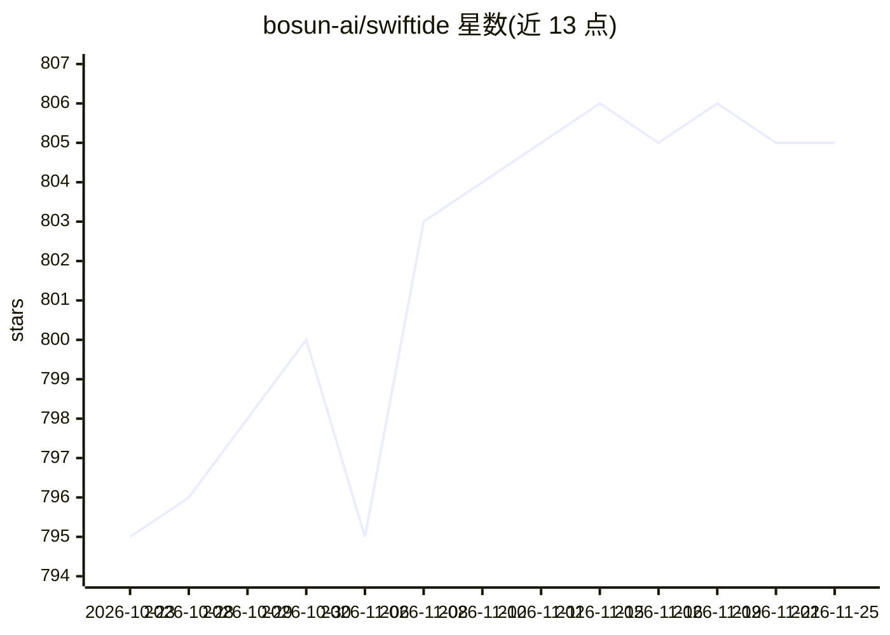

# bosun-ai/swiftide

⭐ 805 · Rust · MIT · 推送 2026-11-23 · [GitHub](https://github.com/bosun-ai/swiftide) · [官网](https://swiftide.rs) · 组织维护

**面向 Rust 开发者的 LLM 应用构建框架：agent 与 RAG 管线**

用 Rust 编写的 LLM 应用框架，提供三部分能力：agent harness（工具调用、生命周期钩子、停止条件、人审恢复）、强类型任务图编排（分叉/汇合、暂停恢复）、流式可组合的 RAG 索引与查询管线（加载-转换-嵌入-存储-检索）。集成按 feature 门控，覆盖多家 LLM 提供商、MCP 工具箱、多种存储后端与 Langfuse 观测。安装通过 cargo add，项目处于 pre-1.0，API 可能变化。

## 筛选速览

| 维度 | 判定 | 备注 |
|---|---|---|
| AI 角色 | `ai-ecosystem` | LLM/agent 周边工具 |
| 许可风险 | `permissive` | MIT |
| 部署形态 | `None` |  |
| 模型依赖 | local-ok | 支持本地模型 |
| 硬件要求 | — | 无带数字的原话,不猜 |
| 安装摩擦 | `low` | 无编译、无系统依赖或容器化 |
| 成熟度 | `idea` | |

## 能力要点

- agent harness：函数工具、MCP 工具箱、流式响应、human-in-the-loop 审批
- 强类型任务图：编译期类型检查的分叉/汇合编排
- 流式 RAG 管线：支持混合搜索、重排序模式与评估
- feature 门控集成：OpenAI/Anthropic/Gemini/Ollama、Qdrant/Redis/PgVector 等

## 适用场景

- 在 Rust 中构建带工具调用的 LLM agent
- 搭建代码/文档索引与检索问答管线
- 编排多步骤、需人工审批或可暂停恢复的任务流

## 场景标签

`RAG` `Agent 框架` · 领域:Agent 开发

## 证据(README 行号)

> L27: Swiftide is an opinionated framework for building LLM applications. It gives you
> L175: Swiftide includes first-class indexing and querying pipelines for retrieval-augmented generation.

## 星数曲线

2026-10-23 795 → 2026-11-25 805（+10）

---
*卡片 v1 · prompt 1.4 · 生成 2026-11-24 · 置信度 high · 依据 README sha `eb3aeefb81cc` · [字段定义](../../DATASET.md)*
