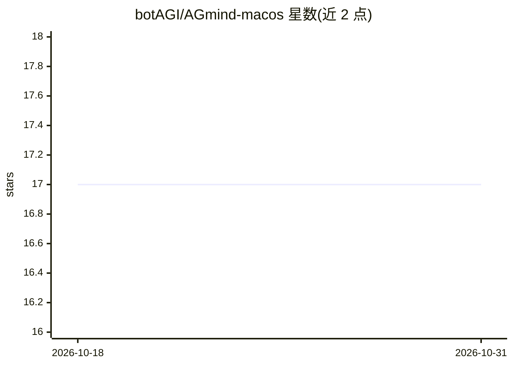

# botAGI/AGmind-macos

⭐ 17 · Shell · Apache-2.0 · 推送 2026-03-24 · [GitHub](https://github.com/botAGI/AGmind-macos) · [官网](https://agmind.dev/macos) · 个人维护

**macOS 一键安装本地 AI/RAG 全栈的安装器**

Bash 编写的 macOS 一键安装脚本：通过 9 个阶段部署 Dify、Open WebUI、原生 Ollama（Homebrew 安装、Metal GPU 加速）、Weaviate/Qdrant、PostgreSQL、Redis、Nginx，可选装 Open Notebook 与 DB-GPT。处理 macOS 特有问题（LaunchAgents、BSD 工具、Docker 网络等），提供硬件检测与按内存推荐模型的向导、dry-run 模式、LAN/offline 两种部署 profile，以及 agmind CLI 做启停、健康检查与备份。附带 230 个单元测试。

## 筛选速览

| 维度 | 判定 | 备注 |
|---|---|---|
| AI 角色 | `ai-ecosystem` | LLM/agent 周边工具 |
| 许可风险 | `permissive` | Apache-2.0 |
| 部署形态 | `self-host` | docker 或自建部署 |
| 模型依赖 | local-ok | 支持本地模型 |
| 硬件要求 | — | 无带数字的原话,不猜 |
| 安装摩擦 | `low` | 无编译、无系统依赖或容器化 |
| 成熟度 | — | 结构信号不足 |

## 能力要点

- 9 阶段部署本地 AI/RAG 全栈（Dify、Open WebUI、Ollama、向量库等）
- Ollama 原生 Homebrew 安装，支持 Metal GPU 加速
- 提供 agmind CLI（status/doctor/backup/start/stop/uninstall）
- 支持 dry-run、非交互模式与 LAN/offline profile

## 适用场景

- 在 Mac 上一键搭建自托管的本地 LLM 与 RAG 服务
- 在 Apple Silicon 设备上获得 Metal 加速的本地推理环境
- 为局域网或离线环境部署私有 AI 工作台

## 场景标签

 · 领域:AI 基础设施部署/自托管

## 证据(README 行号)

> L10: One-command installer for a full local AI/RAG stack on macOS.
> L11: Deploys **Dify, Open WebUI, Ollama, Weaviate/Qdrant, PostgreSQL, Redis, Nginx** — with optional **Open Notebook** a
> L40: |4. Ollama Setup|Native Ollama via Homebrew — Metal GPU acceleration|

## 星数曲线

2026-10-18 17 → 2026-10-31 17（+0）

---
*卡片 v1 · prompt 1.4 · 生成 2026-10-29 · 置信度 mid · 依据 README sha `152870ac59b9` · [字段定义](../../DATASET.md)*
