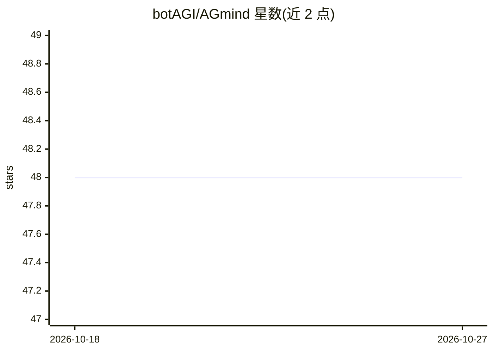

# botAGI/AGmind

⭐ 48 · Shell · NOASSERTION · 推送 2026-07-27 · [GitHub](https://github.com/botAGI/AGmind) · [官网](https://agmind.ai) · 组织维护

**面向 NVIDIA DGX Spark 的一键私有化 RAG 平台安装器**

在 DGX Spark（GB10、128GB 统一内存、aarch64）上一条命令部署 30+ 容器的私有 RAG 技术栈：Dify + vLLM + Weaviate/Qdrant + RAGFlow + Docling + Prometheus/Grafana 监控，含交互式向导、硬件自检与可选双机 QSFP 200G 集群。本地运行 gemma-4-26B 与 bge-m3/reranker，文档与查询不出本机。提供 Day-2 CLI（status/backup/update 等）与 UFW/fail2ban 等加固；x86_64 支持已移除，仅限 GB10 平台，且限制 NVIDIA 驱动不超过 580.x。面向 DevOps、ML 团队与 IT 部门。

## 筛选速览

| 维度 | 判定 | 备注 |
|---|---|---|
| AI 角色 | `ai-ecosystem` | LLM/agent 周边工具 |
| 许可风险 | `none` | NOASSERTION |
| 部署形态 | `self-host` | docker 或自建部署 |
| 模型依赖 | local-ok | 支持本地模型 |
| 硬件要求 | — | 无带数字的原话,不猜 |
| 安装摩擦 | `low` | 无编译、无系统依赖或容器化 |
| 成熟度 | — | 结构信号不足 |

## 能力要点

- 一条命令约 25–30 分钟完成 30+ 容器部署（向导→配置→拉取→启动）
- 部署 Dify + vLLM + RAGFlow + Docling + 监控的完整 RAG 技术栈
- 支持双 Spark 经 QSFP 200G 组成两节点集群，peer 节点运行 vLLM
- 提供 agmind status/health/backup/update 等 Day-2 运维 CLI

## 适用场景

- 在 DGX Spark 上搭建零数据外流的私有 RAG 问答平台
- ML/IT 团队部署含监控与安全加固的本地 LLM 服务栈
- 两台 Spark 通过 QSFP 直连扩展 GPU 推理节点

## 场景标签

`RAG` · 领域:知识与检索

## 证据(README 行号)

> L27: AGMind is a one-command installer for a private RAG platform on **NVIDIA DGX
> L29: Compose: **Dify + vLLM + Weaviate/Qdrant + RAGFlow + Docling + monitoring**,
> L37: **Built for:** DevOps engineers, ML teams, and IT departments running a

## 星数曲线

2026-10-18 48 → 2026-10-27 48（+0）

---
*卡片 v1 · prompt 1.4 · 生成 2026-10-25 · 置信度 mid · 依据 README sha `463a561bcf92` · [字段定义](../../DATASET.md)*
