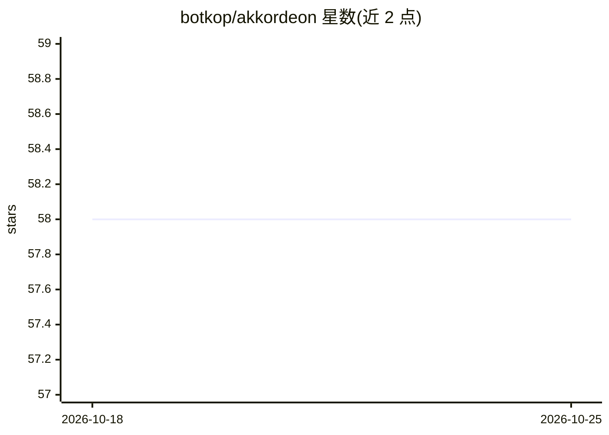

# botkop/akkordeon

⭐ 58 · Scala · 推送 2026-01-06 · [GitHub](https://github.com/botkop/akkordeon) · 个人维护

**用 Akka actor 训练分布式神经网络的 Scala 实验项目**

以 Scala/Akka 演示如何将神经网络的层、数据提供者等组件封装为独立的 actor（gate/sentinel），前后向传播结果以消息在 actor 间传递，各层异步计算，每个 gate 持有自己的优化器（采用延迟补偿的异步 SGD 缓解延迟梯度问题）。支持单机或多 JVM、多机器集群部署，可动态增删训练/验证/测试模块，为在线学习提供基础设施。构建需 sbt 与 MNIST 数据集，通过 scripts 脚本下载。属于学习/实验性质项目，非生产框架。

## 筛选速览

| 维度 | 判定 | 备注 |
|---|---|---|
| AI 角色 | `ai-ecosystem` | LLM/agent 周边工具 |
| 许可风险 | `none` | — |
| 部署形态 | `None` |  |
| 模型依赖 | — | README 未给出锁定关系 |
| 硬件要求 | — | 无带数字的原话,不猜 |
| 安装摩擦 | `low` | 无编译、无系统依赖或容器化 |
| 成熟度 | — | 结构信号不足 |

## 能力要点

- 将神经网络层封装为 Akka actor（gate），各层异步计算
- 每个 gate 持有独立优化器，采用延迟补偿的异步 SGD
- 支持单机、多 JVM、多机器集群部署
- 可动态添加/移除训练、验证与测试模块

## 适用场景

- 学习如何用 actor 模型组织神经网络训练
- 在多台机器上分布式部署训练与验证组件
- 实验在线学习场景下的模块动态增删

## 场景标签

`模型训练` · 领域:训练与推理

## 证据(README 行号)

> L3: This project shows how to train an artificial neural network in an actor framework. Traditional neural networks are 
> L13: A layer is embedded in a gate. A gate is an actor.
> L59: After having cloned/downloaded the source code of this project, get the MNIST dataset by executing the script `scri

## 星数曲线

2026-10-18 58 → 2026-10-25 58（+0）

---
*卡片 v1 · prompt 1.4 · 生成 2026-10-24 · 置信度 mid · 依据 README sha `6b4fbf2766a2` · [字段定义](../../DATASET.md)*
