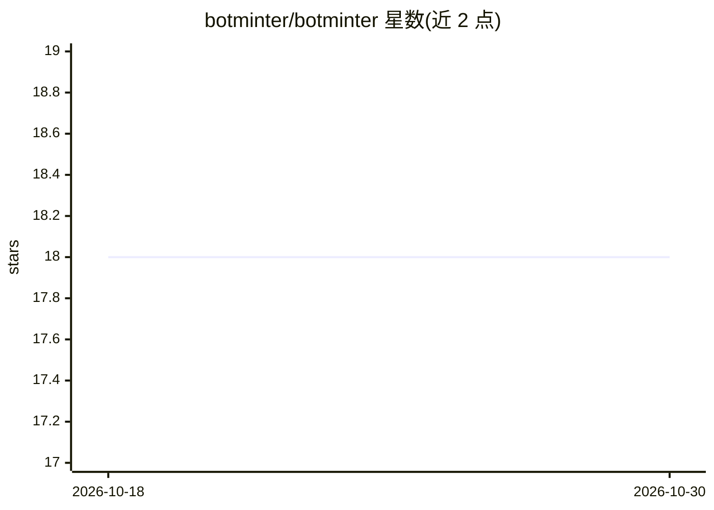

# botminter/botminter

⭐ 18 · Rust · Apache-2.0 · 推送 2026-06-19 · [GitHub](https://github.com/botminter/botminter) · [官网](https://www.botminter.ai) · 个人维护

**管理多编码 agent 团队的 CLI：统一约定、知识与约束**

面向运行多个编码 agent 的开发者的 CLI 工具：将流程、知识与约束放在 Git 仓库中，通过四层作用域（team→project→member→member+project）自动分发给各 agent；以 profiles 形式提供角色、质量门、通信方式与工作区布局的默认配置；agent 间通过 GitHub Issues 协调以保留可追溯的决策记录。当前版本支持 Claude Code（需配合 Ralph Orchestrator 补丁构建与 gh CLI），架构预留对 Gemini CLI、Codex 的支持。Rust 实现，提供安装脚本。

## 筛选速览

| 维度 | 判定 | 备注 |
|---|---|---|
| AI 角色 | `ai-ecosystem` | LLM/agent 周边工具 |
| 许可风险 | `permissive` | Apache-2.0 |
| 部署形态 | `None` |  |
| 模型依赖 | — | README 未给出锁定关系 |
| 硬件要求 | — | 无带数字的原话,不猜 |
| 安装摩擦 | `low` | 无编译、无系统依赖或容器化 |
| 成熟度 | `idea` | |

## 能力要点

- 四层可叠加的知识与约束作用域体系
- Git 仓库承载约定，agent 启动时自动拾取
- profiles 提供角色/流程/质量门/工作区的默认配置
- agent 通过 GitHub Issues 协调，决策可追溯

## 适用场景

- 我在多个项目上运行多个编码 agent，想让它们共用一套约定
- 我希望更新一条约定后所有相关 agent 自动生效
- 我想在面板上追踪各 agent 的决策而不是翻终端日志

## 场景标签

`多智能体` · 领域:Agent 开发

## 证据(README 行号)

> L8: BotMinter is a CLI that brings conventions to running a team of coding agents. Your process, knowledge, and constrai
> L12: Most tools in this space focus on how to run agents - spawning them, orchestrating multi-agent pipelines, managing 

## 星数曲线

2026-10-18 18 → 2026-10-30 18（+0）

---
*卡片 v1 · prompt 1.4 · 生成 2026-10-29 · 置信度 high · 依据 README sha `9ed4a2463112` · [字段定义](../../DATASET.md)*
