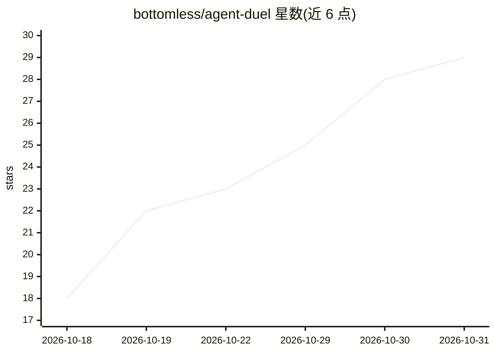

# bottomless/agent-duel

⭐ 29 · TypeScript · NOASSERTION · 推送 2026-10-30 · [GitHub](https://github.com/bottomless/agent-duel) · 组织维护

**双编码代理盲战对局的桌面应用：一个提示词，用户投票选优**

基于 Paseo 的 Electron 桌面应用：在隔离的本地 worktree 中让两个匿名编码代理处理同一提示词，用户对比结果并投 A、B 或平局，胜出的结果作为聊天历史继续。模型从池中随机抽取，投票后才揭示身份；官方下载经其闭源云服务与 OpenRouter 调用模型，需邮箱注册；本地开发可用 BYOK 模式跑自己的 OpenRouter key。执行与 SQLite 历史均留在本机。

## 筛选速览

| 维度 | 判定 | 备注 |
|---|---|---|
| AI 角色 | `ai-ecosystem` | LLM/agent 周边工具 |
| 许可风险 | `none` | NOASSERTION |
| 部署形态 | `library` | 以包/库形式分发 |
| 模型依赖 | locked-api |  |
| 硬件要求 | — | 无带数字的原话,不猜 |
| 安装摩擦 | `low` | 无编译、无系统依赖或容器化 |
| 成熟度 | — | 结构信号不足 |

## 能力要点

- 两个匿名编码代理在同一提示词上对局，投票后揭示模型身份
- 隔离本地 worktree 执行，SQLite 记录历史与产物
- 官方下载含托管云服务模式，本地开发支持 BYOK 自带 OpenRouter key
- 投票选中的结果延续为聊天历史并写入仓库

## 适用场景

- 对比不同模型在同一编码任务上的表现
- 以盲测投票方式挑选心仪的编码代理
- 本地隔离环境中运行代理对局并保留历史

## 场景标签

`模型评测` · 领域:评测与运维

## 证据(README 行号)

> L7: Agent Duel runs two blinded coding agents against one prompt in isolated local
> L109: - `arena-backend/packages/arena-service` — battle routes (model draw, model proxy,

## 星数曲线

2026-10-18 18 → 2026-10-31 29（+11）

---
*卡片 v1 · prompt 1.4 · 生成 2026-10-27 · 置信度 high · 依据 README sha `87021d3c28e7` · [字段定义](../../DATASET.md)*
