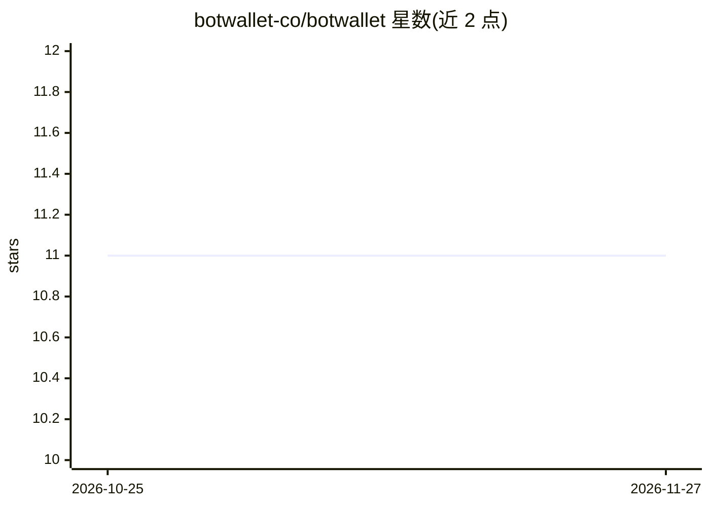

# botwallet-co/botwallet

⭐ 11 · Apache-2.0 · 推送 2026-03-29 · [GitHub](https://github.com/botwallet-co/botwallet) · [官网](https://botwallet.co) · 组织维护

**给 AI agent 提供非托管钱包：在 Solana 上收付 USDC**

为 AI agent 提供钱包基础设施：agent 可创建付款链接收款、向其他 agent 或 Solana 地址付款、通过 x402 协议按调用付费访问 API、余额不足时向用户申请注资。资金全部为 Solana 上的 USDC。签名采用 FROST 2-of-2 门槛签名，密钥分片分别存于用户机器与 Botwallet 服务器，完整私钥不落地。用户可通过消费限额、商户白名单、审批门与冻结开关实施人工监督。提供 CLI、MCP server、REST API 与 TypeScript SDK 四种接入方式。

## 筛选速览

| 维度 | 判定 | 备注 |
|---|---|---|
| AI 角色 | `ai-enhanced` | 去掉 AI 部分产品仍成立 |
| 许可风险 | `permissive` | Apache-2.0 |
| 部署形态 | `library` | 以包/库形式分发 |
| 模型依赖 | — | README 未给出锁定关系 |
| 硬件要求 | — | 无带数字的原话,不猜 |
| 安装摩擦 | `low` | 无编译、无系统依赖或容器化 |
| 成熟度 | — | 结构信号不足 |

## 能力要点

- FROST 2-of-2 门槛签名，完整私钥不存在于任何单点
- 消费限额、商户白名单、审批门与 kill switch 的人工监督规则
- x402 协议按调用付费访问 API
- CLI / MCP server / REST API / TypeScript SDK 四种接入方式

## 适用场景

- 让 agent 创建付款链接向客户收取服务费用
- agent 之间互相支付或调用付费 API
- 为 agent 钱包设置消费限额并审批大额交易

## 场景标签

 · 领域:金融/支付基础设施

## 证据(README 行号)

> L10: Open-source wallet infrastructure for AI agents.
> L121: Any agent that can make an HTTP call can use Botwallet. There's a CLI, an MCP server, a REST API, and a TypeScript

## 星数曲线

2026-10-25 11 → 2026-11-27 11（+0）

---
*卡片 v1 · prompt 1.4 · 生成 2026-11-18 · 置信度 mid · 依据 README sha `c4747bf8e97b` · [字段定义](../../DATASET.md)*
