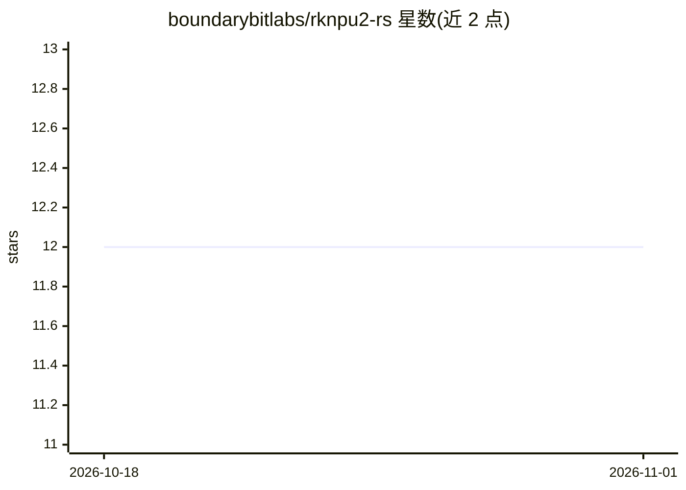

# boundarybitlabs/rknpu2-rs

⭐ 12 · Rust · Apache-2.0 · 推送 2026-09-10 · [GitHub](https://github.com/boundarybitlabs/rknpu2-rs) · 组织维护

**Rockchip NPU 的 RKNN 运行时 Rust 绑定库**

对 Rockchip rknpu2 SDK（librknnrt.so）C API 的 Rust 封装，面向在 Rockchip NPU 上部署深度学习模型的开发者。提供安全惯用的 Rust 抽象，支持加载模型、设置输入、运行推理与读取输出，同时包含低层 -sys 绑定与高层封装。基于 rknpu2 SDK v2.3.2，构建过程不依赖 bindgen，也无需再分发 Rockchip C 头文件。README 使用章节标注 Coming soon，零拷贝缓冲支持列为将有能力。

## 筛选速览

| 维度 | 判定 | 备注 |
|---|---|---|
| AI 角色 | `ai-ecosystem` | LLM/agent 周边工具 |
| 许可风险 | `permissive` | Apache-2.0 |
| 部署形态 | `None` |  |
| 模型依赖 | — | README 未给出锁定关系 |
| 硬件要求 | — | 无带数字的原话,不猜 |
| 安装摩擦 | `low` | 无编译、无系统依赖或容器化 |
| 成熟度 | `idea` | |

## 能力要点

- 安全惯用的 Rust 抽象封装 librknnrt.so C API
- 支持加载模型、设置输入、运行推理、读取输出
- 同时提供低层 -sys 绑定与高层封装
- 基于 rknpu2 SDK v2.3.2，无需再分发 Rockchip C 头文件

## 适用场景

- 在 Rust 项目中调用 Rockchip NPU 运行 RKNN 模型
- 边缘计算设备（如 RK3588）上的深度学习模型部署开发

## 场景标签

`推理引擎` · 领域:训练与推理

## 证据(README 行号)

> L3: Rust bindings for the Rockchip RKNN API (rknpu2), targeting deployment of deep learning models on Rockchip NPUs.
> L14: - Support for loading models, setting inputs, running inference, and reading outputs

## 星数曲线

2026-10-18 12 → 2026-11-01 12（+0）

---
*卡片 v1 · prompt 1.4 · 生成 2026-11-01 · 置信度 high · 依据 README sha `6a93c37b9c55` · [字段定义](../../DATASET.md)*
